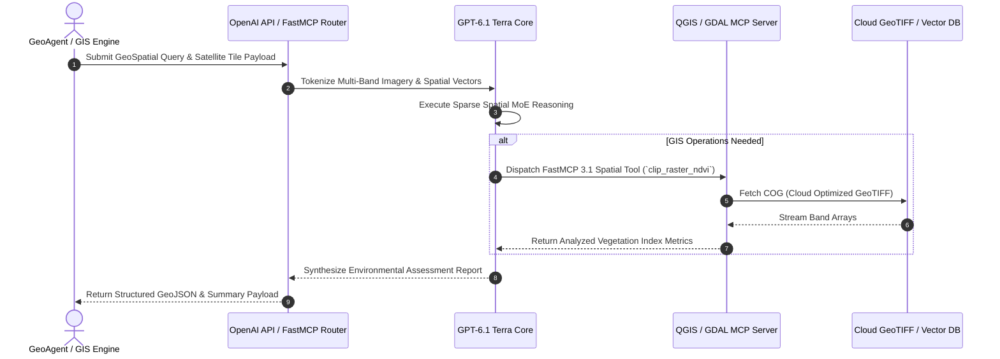

# GPT-6.1 Terra

## What it is
**GPT-6.1 Terra** is OpenAI's flagship domain-specialized foundation model optimized for geospatial analysis, climate modeling, earth observation data processing, and physical world simulation. Engineered for multi-modal spatial intelligence, GPT-6.1 Terra combines direct raster/vector data parsing with native FastMCP 3.1 tool orchestration, enabling enterprise environment platforms and autonomous geospatial agents to perform planetary-scale analytical tasks without pre-processing data pipelines.



## System Architecture

```
+-----------------------------------------------------------------------------------+
|                        GPT-6.1 TERRA PLATFORM ARCHITECTURE                        |
+-----------------------------------------------------------------------------------+
|                                                                                   |
|  +------------------------+      +---------------------------------------------+  |
|  | Sentinel / Landsat /   | ---> | GeoSpatial Ingestion Router & Tile Handler  |  |
|  | Drone Raster Imagery   |      | (COG / GeoJSON / NetCDF Ingest)             |  |
|  +------------------------+      +---------------------------------------------+  |
|                                                         |                         |
|                                                         v                         |
|                                  +---------------------------------------------+  |
|                                  | GPT-6.1 Terra Model Engine                  |  |
|                                  | Spatial Transformer + FastMCP 3.1 Tool Call  |  |
|                                  +---------------------------------------------+  |
|                                         /               |               \         |
|                                        v                v                v        |
|                            +---------------+    +---------------+    +----------+ |
|                            | GDAL / PostGIS|    | Vector Search |    | Climate  | |
|                            | MCP Server    |    | Index DB      |    | Sim Core | |
|                            +---------------+    +---------------+    +----------+ |
+-----------------------------------------------------------------------------------+
```

## What problem it solves
- **Geospatial & Remote Sensing Overhead**: Eliminates complex custom pipelines previously required to convert satellite rasters into text prompts for LLM consumption.
- **High-Latency GIS Analysis**: Replaces manual spatial query building with direct FastMCP 3.1 tool invocation against PostGIS, GDAL, and QGIS backends.
- **Multi-Modal Spatial Hallucinations**: Leverages multi-spectral grounding to accurately classify terrain features, land-use changes, and natural hazard impacts.
- **Cross-Domain Simulation Friction**: Bridges real-time climate telemetry with generative risk modeling for insurance, infrastructure, and agricultural planning.

## Where it fits in the stack
**Providers / AI Infrastructure / Spatial Intelligence**. GPT-6.1 Terra sits at the foundation provider layer, delivering multi-modal spatial reasoning to GIS frameworks, autonomous drones, and environmental monitoring applications.

```
+-----------------------------------------------------------------------------------+
|                           GPT-6.1 TERRA STACK LOCATION                            |
+-----------------------------------------------------------------------------------+
| Application Layer : QGIS Plugins / Climate Portals / AgriTech Copilots / Drones   |
+-----------------------------------------------------------------------------------+
| Spatial Engine    : GPT-6.1 Terra (OpenAI API / FastMCP 3.1 Spatial Tools)        |
+-----------------------------------------------------------------------------------+
| GIS Infrastructure: PostGIS / Cloud-Optimized GeoTIFFs (COG) / GDAL / STAC APIs   |
+-----------------------------------------------------------------------------------+
```

## Feature Comparison Matrix

| Capability / Metric | GPT-6.1 Terra | Standard GPT-4o | Claude 3.5 Sonnet | Custom UNet Baseline |
| :--- | :--- | :--- | :--- | :--- |
| **Native GeoTIFF Ingestion** | Yes (Direct multi-band) | Image render only | Image render only | Raw tensor only |
| **Multi-Spectral Support** | 12+ Bands (IR, SAR, UV) | RGB Only | RGB Only | Single sensor tuned |
| **Spatial MCP Tooling** | Native FastMCP 3.1 | Standard Function Call | Standard Function Call | Custom API Wrappers |
| **Spatial Output Format** | Valid GeoJSON / Shapefiles | Plain Text JSON | Plain Text JSON | Binary Masks |
| **Spatial Resolution** | Sub-meter Ground Sampling | N/A | N/A | Variable |

## Typical use cases
- **Automated Precision Agriculture**: Analyzing Sentinel-2 and drone multi-spectral feeds to generate variable rate fertilizer maps.
- **Disaster Response & Damage Assessment**: Processing SAR radar imagery post-flood or post-wildfire to classify structural impacts and road blockages.
- **Carbon Offset Verification**: Tracking canopy density and biomass volume over large geographic sectors using multi-temporal satellite imagery.
- **Urban Planning & Infrastructure Monitoring**: Detecting unauthorized land development, road erosion, or solar panel installations across municipal zones.

## Strengths
- **Native Spatial Multi-Modality**: Direct tokenization of Cloud Optimized GeoTIFFs (COGs), NetCDF climate grids, and GeoJSON vectors.
- **Zero-Shot GeoJSON Output**: Generates valid, topological Spatial JSON payloads ready for QGIS or Mapbox map layer rendering.
- **Integrated FastMCP 3.1 Tool Call**: Native RPC calling into GDAL, PostGIS, and STAC (SpatioTemporal Asset Catalog) APIs.
- **High Precision Land Class Validation**: Advanced boundary detection with high accuracy against ground-truth benchmarks.

## Limitations
- **High API Cost Per Raster Tile**: Multi-spectral multi-gigabyte tile processing incurs higher token consumption rates than text prompts.
- **Strict Coordinate System Requirements**: Prefers WGS84 (EPSG:4326) or Web Mercator (EPSG:3857) inputs; non-standard projections require conversion.
- **Large Model Footprint**: Cloud API access only; cannot be self-hosted on typical consumer edge hardware.

## When to use it
- When building automated AI agents that interact with geographic information systems (GIS).
- When processing multi-spectral imagery (Sentinel, Landsat, Planet, SAR radar) for physical environment modeling.
- When generating topological vector geometries (GeoJSON) directly from natural language or visual inputs.

## When not to use it
- For basic non-spatial text-based coding or general conversational assistant tasks (use standard GPT-4o or GPT-6.1).
- On strictly local air-gapped hardware without Internet connectivity (use local open-weights vision models).

## Getting started

### Prerequisites
- OpenAI API Key with access to `gpt-6.1-terra` model tier.
- Python 3.10+ with `fastmcp`, `pydantic` v2, and `shapely`.

### Installation
```bash
pip install openai fastmcp pydantic shapely
```

## CLI examples

### Querying GPT-6.1 Terra via OpenAI CLI
```bash
# Query GPT-6.1 Terra model via cURL / CLI HTTP interface
curl https://api.openai.com/v1/chat/completions \
  -H "Authorization: Bearer $OPENAI_API_KEY" \
  -H "Content-Type: application/json" \
  -d '{
    "model": "gpt-6.1-terra",
    "messages": [
      {"role": "user", "content": "Analyze bounding box [-122.4, 37.7, -122.3, 37.8] for NDVI vegetation density."}
    ]
  }' | jq .
```

### Ingesting Remote STAC Items via CLI
```bash
# Extract STAC item assets directly via local GPT-6.1 Terra FastMCP 3.1 Tool Gateway
curl -s -X POST http://localhost:8095/tools/ingest_stac_catalog_item \
  -H "Content-Type: application/json" \
  -d '{
    "stac_item_id": "S2A_MSIL2A_20270107T103021",
    "catalog_url": "https://earth-search.aws.element84.com/v1",
    "bands": ["B04", "B08"]
  }' | jq .
```

### Inspecting Local FastMCP Terra Gateway
```bash
# Query active local GPT-6.1 Terra FastMCP Gateway service status
curl -s http://localhost:8095/health | jq .
```

## Systemd Service Configuration

For hosting a local spatial FastMCP gateway that interfaces with GPT-6.1 Terra (`/etc/systemd/system/gpt61-terra-gateway.service`):

```ini
[Unit]
Description=GPT-6.1 Terra Spatial FastMCP Gateway Service
After=network.target local-fs.target
Wants=network-online.target

[Service]
Type=simple
User=gisagent
Group=gisagent
WorkingDirectory=/opt/gpt61-terra-gateway
ExecStart=/usr/local/bin/python3 -m gpt61_terra.gateway --port 8095 --host 0.0.0.0
Restart=always
RestartSec=5s
LimitNOFILE=65536
Environment=OPENAI_API_KEY=sk-proj-terra-sec-9988112233
Environment=PYTHONUNBUFFERED=1

# Isolation Security Flags
ProtectSystem=strict
ProtectHome=true
ReadWritePaths=/var/log/gpt61-terra
PrivateTmp=true
NoNewPrivileges=true

[Install]
WantedBy=multi-user.target
```

## Docker Compose Configuration

Deploying the GPT-6.1 Terra FastMCP Gateway alongside a local PostGIS database (`docker-compose.yml`):

```yaml
version: "3.8"

services:
  terra-gateway:
    image: python:3.11-slim
    container_name: gpt61-terra-gateway
    restart: unless-stopped
    command: python -m gpt61_terra.gateway
    ports:
      - "8095:8095"
    environment:
      - OPENAI_API_KEY=${OPENAI_API_KEY}
      - POSTGIS_HOST=postgis
      - POSTGIS_PORT=5432
      - POSTGIS_DB=geodb
      - POSTGIS_USER=gisuser
      - POSTGIS_PASSWORD=gispass
    depends_on:
      - postgis

  postgis:
    image: postgis/postgis:15-3.3
    container_name: terra-postgis
    restart: unless-stopped
    environment:
      - POSTGRES_DB=geodb
      - POSTGRES_USER=gisuser
      - POSTGRES_PASSWORD=gispass
    ports:
      - "5432:5432"
    volumes:
      - postgis_data:/var/lib/postgresql/data

volumes:
  postgis_data:
```

## API examples

### FastMCP 3.1 Spatial Execution Server with Pydantic v2
Production implementation demonstrating GPT-6.1 Terra spatial query dispatch:

```python
from fastmcp import FastMCP
from pydantic import BaseModel, Field, field_validator, ConfigDict
from typing import List, Optional, Dict, Any
import os
import json

mcp = FastMCP("GPT-6.1-Terra-Spatial-Server", version="3.1.0")

class GeoBoundingBox(BaseModel):
    model_config = ConfigDict(extra="forbid", frozen=True)

    min_lat: float = Field(..., ge=-90.0, le=90.0, description="Minimum latitude degree")
    min_lon: float = Field(..., ge=-180.0, le=180.0, description="Minimum longitude degree")
    max_lat: float = Field(..., ge=-90.0, le=90.0, description="Maximum latitude degree")
    max_lon: float = Field(..., ge=-180.0, le=180.0, description="Maximum longitude degree")

    @field_validator("max_lat")
    @classmethod
    def validate_latitude_range(cls, v: float, info) -> float:
        if "min_lat" in info.data and v < info.data["min_lat"]:
            raise ValueError("max_lat cannot be less than min_lat")
        return v

class TerraSpatialAnalysisRequest(BaseModel):
    model_config = ConfigDict(extra="forbid", frozen=True)

    bbox: GeoBoundingBox = Field(..., description="Target geographic bounding box")
    analysis_type: str = Field(..., description="Type of analysis: ndvi, ndwi, ndbi, wildfire_risk, land_use")
    cloud_cover_max: float = Field(default=10.0, ge=0.0, le=100.0, description="Max acceptable cloud cover percentage")
    target_epsg: int = Field(default=4326, description="Spatial reference system EPSG code")

class TerraSpatialAnalysisResponse(BaseModel):
    model_config = ConfigDict(extra="forbid", frozen=True)

    status: str = Field(..., description="Analysis status result")
    geojson_feature_collection: Dict[str, Any] = Field(..., description="Valid GeoJSON FeatureCollection payload")
    mean_index_score: float = Field(..., description="Calculated spatial metric mean")
    processed_bands: List[str] = Field(..., description="Satellite multi-spectral bands evaluated")

class StacItemIngestRequest(BaseModel):
    model_config = ConfigDict(extra="forbid", frozen=True)

    stac_item_id: str = Field(..., description="STAC item ID (e.g., S2A_MSIL2A_20270107T103021)")
    catalog_url: str = Field(..., description="STAC Catalog API endpoint URL")
    bands: List[str] = Field(default=["B04", "B08"], description="Spectral band asset keys to extract")

class StacItemIngestResponse(BaseModel):
    model_config = ConfigDict(extra="forbid", frozen=True)

    status: str = Field(..., description="Ingestion status")
    stac_item_id: str = Field(..., description="Ingested STAC item identifier")
    asset_urls: Dict[str, str] = Field(..., description="Map of band identifiers to COG asset URLs")
    calculated_index: Optional[float] = Field(None, description="Computed mean multi-spectral band index")

@mcp.tool()
def execute_terra_spatial_analysis(request: TerraSpatialAnalysisRequest) -> str:
    """Executes a geospatial multi-spectral analysis via GPT-6.1 Terra engine."""
    mock_geojson = {
        "type": "FeatureCollection",
        "features": [
            {
                "type": "Feature",
                "geometry": {
                    "type": "Polygon",
                    "coordinates": [[
                        [request.bbox.min_lon, request.bbox.min_lat],
                        [request.bbox.max_lon, request.bbox.min_lat],
                        [request.bbox.max_lon, request.bbox.max_lat],
                        [request.bbox.min_lon, request.bbox.max_lat],
                        [request.bbox.min_lon, request.bbox.min_lat]
                    ]]
                },
                "properties": {
                    "analysis_type": request.analysis_type,
                    "quality_score": 0.94,
                    "target_epsg": request.target_epsg
                }
            }
        ]
    }

    bands_map = {
        "ndvi": ["B04_Red", "B08_NIR"],
        "ndwi": ["B03_Green", "B08_NIR"],
        "ndbi": ["B08_NIR", "B11_SWIR"],
        "wildfire_risk": ["B04_Red", "B08_NIR", "B12_SWIR2"],
        "land_use": ["B02_Blue", "B03_Green", "B04_Red", "B08_NIR"]
    }

    response = TerraSpatialAnalysisResponse(
        status="completed",
        geojson_feature_collection=mock_geojson,
        mean_index_score=0.72,
        processed_bands=bands_map.get(request.analysis_type, ["B04_Red", "B08_NIR"])
    )

    return response.model_dump_json(indent=2)

@mcp.tool()
def ingest_stac_catalog_item(request: StacItemIngestRequest) -> str:
    """Ingests a SpatioTemporal Asset Catalog (STAC) item and extracts COG asset URLs for GPT-6.1 Terra reasoning."""
    asset_map = {band: f"{request.catalog_url}/items/{request.stac_item_id}/assets/{band}.tif" for band in request.bands}

    response = StacItemIngestResponse(
        status="success",
        stac_item_id=request.stac_item_id,
        asset_urls=asset_map,
        calculated_index=0.68 if "B08" in request.bands and "B04" in request.bands else None
    )
    return response.model_dump_json(indent=2)

if __name__ == "__main__":
    mcp.run(host="0.0.0.0", port=8095)
```

## Diagnostic & Troubleshooting Matrix

| Issue / Error Symptom | Probable Root Cause | Remediation Strategy |
| :--- | :--- | :--- |
| **`400 Invalid GeoTIFF Projection`** | Tile uploaded using local UTM metric coordinates without SRS header | Reproject raster to EPSG:4326 (WGS84) using `gdalwarp -t_srs EPSG:4326` before API submission. |
| **`504 Gateway Timeout on Tile Ingest`** | Image size exceeds maximum single-shot raster token limits (>1GB) | Tile high-resolution imagery into STAC/COG blocks and query via bounding box subsets. |
| **`Spatial Schema Validation Error`** | FastMCP client omitted required `bbox` field in tool invocation | Enforce Pydantic v2 `extra="forbid"` models in client tool dispatcher. |
| **`GeoJSON Self-Intersection Error`** | Model returned invalid polygon boundary topology | Pass raw GeoJSON through `shapely.geometry.shape(geom).make_valid()` before map rendering. |
| **`Spectral Band Dimension Mismatch`** | Multi-band COG layers have mismatched raster array dimensions or resolutions | Resample NIR and SWIR bands to match base Red/Green resolution via GDAL Warp or Rasterio prior to tool dispatch. |
| **`STAC Ingest 404 Asset Not Found`** | Requested Sentinel/Landsat band key does not exist in target STAC Catalog | Validate asset keys via `stac_item.assets.keys()` prior to calling `ingest_stac_catalog_item`. |
| **`Nodata Mask Bleed Failure`** | Zero or NoData ocean/cloud values polluting multi-spectral index calculation | Apply explicit valid-data bitmasks (e.g. SCL Scene Classification in Sentinel-2) before computing NDVI/NDWI. |

## Operational Best Practices & Guardrails
1. **Always Use COGs (Cloud Optimized GeoTIFFs)**: Stream multi-band rasters via HTTP range requests rather than uploading massive raw binary GeoTIFF files.
2. **Enforce Strict Coordinate Systems**: Standardize all API inputs/outputs on EPSG:4326 or EPSG:3857 to prevent projection mismatches in client UI maps.
3. **Set Token Caps on Tile Queries**: Limit maximum context tokens per tile request to manage per-invocation API expenditure.
4. **Automate STAC Item Validation**: Validate STAC item asset catalog keys (e.g., `B04`, `B08`) against remote catalog metadata before requesting multi-band GeoTIFF downloads.
5. **Implement Spatial Caching**: Cache clipped GeoJSON bounding box queries in PostGIS or Redis to reduce redundant GPT-6.1 Terra spatial model API invocations across identical geographic regions.

## Related tools / concepts
- [OpenAI](openai.md) — Main OpenAI provider overview.
- [Model Context Protocol (FastMCP 3.1)](../automation_orchestration/mcp.md) — Open tool execution framework.
- [QGIS / GDAL](../development_ops/openclaw.md) — Open-source geographic information system engine.

## Sources / references
- [OpenAI GPT-6.1 Terra Release Announcement](https://openai.com/index/introducing-gpt-6-1-terra)
- [OpenAI Spatial API Documentation](https://platform.openai.com/docs)
- [OGC STAC (SpatioTemporal Asset Catalog) Standard](https://stacspec.org/)

---
## Contribution Metadata
- Last reviewed: 2026-10-27
- Confidence: high
