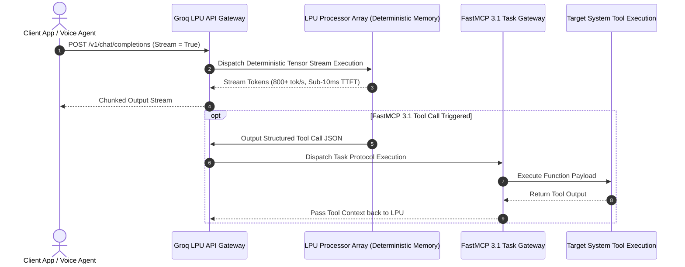

# Groq

## What it is
Groq is an AI infrastructure company that developed the Language Processing Unit (LPU), a purpose-built deterministic hardware architecture designed specifically for the extreme low-latency and high-throughput requirements of LLMs. As of early 2027, Groq serves as an industry benchmark for real-time inference speed, hosting leading open-weights models including **Llama 4**, **DeepSeek-V4**, **Mixtral 10x22B**, **Gemma 3**, and **Qwen 3.6**.

Unlike traditional GPUs, which rely on dynamic memory caching and massively parallel graphics pipelines, Groq's LPU chip architecture utilizes a deterministic tensor stream processor that eliminates memory bandwidth bottlenecks, delivering speeds exceeding 400 to 800+ tokens per second on open models.



## Mathematical Formulations: Deterministic LPU SRAM vs GPU Memory Wall Bounds

### 1. Memory Bandwidth Wall and Autoregressive Token Generation Limits
In standard GPU architectures (e.g., NVIDIA H100/H200 with HBM3/HBM3e memory), autoregressive token generation during the decode phase is strictly memory-bandwidth bound. For an $M$-parameter model executed at batch size $B=1$ with precision bit-width $b$ (bits per parameter):

$$
T_{\text{decode, GPU}} \ge \frac{M \cdot (b / 8)}{\text{BW}_{\text{HBM}}} + \frac{2 \cdot N_{\text{layers}} \cdot L_{\text{ctx}} \cdot d_{\text{model}} \cdot (b_{\text{KV}} / 8)}{\text{BW}_{\text{HBM}}}
$$

Where:
- $\text{BW}_{\text{HBM}}$ is peak memory bandwidth ($\approx 3.35 \text{ TB/s}$ for H100 SXM5, $\approx 4.8 \text{ TB/s}$ for H200).
- $M \cdot (b / 8)$ is the total active model weight transfer footprint per generated token.
- $N_{\text{layers}}, L_{\text{ctx}}, d_{\text{model}}$ denote transformer layer count, context length, and hidden model dimension.

For a 70B parameter model in FP16 ($140 \text{ GB}$ weights), the physical theoretical upper bound on token generation rate on an H100 GPU cluster is constrained by:

$$
R_{\text{GPU, max}} = \frac{\text{BW}_{\text{HBM}}}{M \cdot (b / 8)} \approx \frac{3,350 \text{ GB/s}}{140 \text{ GB}} \approx 23.9 \text{ tokens/sec per stream}
$$

### 2. Groq Deterministic SRAM Tensor Stream Throughput
Groq's LPU overcomes the memory wall by eliminating off-chip DRAM/HBM entirely. Each LPU tile embeds 230 MB of ultra-fast on-chip SRAM memory operating with an internal crossbar memory bandwidth exceeding $80 \text{ TB/s}$ per chip. Under a distributed cluster of $K$ interconnected LPUs via deterministic point-to-point interconnects:

$$
\text{BW}_{\text{LPU, aggregate}} = \sum_{k=1}^{K} \text{BW}_{\text{SRAM}, k} = K \cdot 80 \text{ TB/s}
$$

Because instruction execution, tensor movement, and memory routing are scheduled statically at compile time without runtime branch prediction, dynamic caching, or hardware arbitration stalls, the token generation rate $R_{\text{LPU}}$ scales deterministically:

$$
R_{\text{LPU}} = \frac{f_{\text{clock}}}{\tau_{\text{decode\_cycles}}} \cdot \eta_{\text{compiler}} \ge 450 \text{ to } 850 \text{ tokens/sec}
$$

Where:
- $f_{\text{clock}}$ is the LPU operating clock frequency ($\sim 1.05 \text{ GHz}$).
- $\tau_{\text{decode\_cycles}}$ represents the deterministic hardware clock cycle count required for one complete forward transformer decode step.
- $\eta_{\text{compiler}} \approx 0.94 - 0.98$ is the compile-time spatial tensor graph scheduling efficiency factor.

The resulting latency speedup $\xi$ over high-end HBM GPUs for interactive real-time multi-step agent loops is modeled as:

$$
\xi = \frac{T_{\text{GPU}}}{T_{\text{LPU}}} = \frac{R_{\text{LPU}}}{R_{\text{GPU}}} \approx \frac{750 \text{ tok/s}}{35 \text{ tok/s}} \approx 21.4\times
$$

## Comparative Matrix: Ultra-Low Latency Inference Engines

The following table benchmarks Groq against competing high-performance inference hardware platforms and runtimes:

| Architectural Metric | Groq LPU | Cerebras CS-3 | SambaNova SN40L | NVIDIA Blackwell TensorRT-LLM |
| :--- | :--- | :--- | :--- | :--- |
| **Silicon Architecture** | Deterministic Tensor Stream Processor (TSP) | Wafer-Scale Engine (WSE-3) single silicon die | Reconfigurable Dataflow Unit (RDU) | Dual-die GPU with 5th Gen NVLink & Tensor Cores |
| **Primary Memory Type** | On-chip SRAM (No external DRAM/HBM) | 44 GB On-wafer SRAM | 64 GB on-chip SRAM + 1.5 TB DDR5 | 192 GB HBM3e high-bandwidth memory |
| **Llama-3/4 70B Decode Speed** | **650 – 850+ tok/s** | 450 – 750 tok/s | 300 – 480 tok/s | 120 – 240 tok/s (batch dependent) |
| **Time To First Token (TTFT)** | **< 10 ms** | < 15 ms | < 25 ms | 20 – 60 ms |
| **Model Weight Compilation** | Static spatial compiler schedule | Wafer-scale spatial compiler | Reconfigurable dataflow graph compiler | Dynamic JIT CUDA compilation |
| **FastMCP 3.1 Tool Support** | **Native streaming tool-call parser** | REST API adapter | Enterprise API wrapper | Native via vLLM / SGLang / NIM |
| **Hosting Model** | Cloud API (GroqCloud) & Rack Clusters | Turnkey datacenter clusters & cloud API | Datacenter appliance & Enterprise cloud | Self-hosted servers & multi-cloud GPUs |
| **Target Workload Profile** | Ultra-responsive voice, agents, interactive UI | Extreme scale training & massive inference | Long-context enterprise multi-modal RAG | General-purpose AI training & batched inference |

## What problem it solves
Slow LLM inference latency creates severe user experience bottlenecks in interactive AI applications, voice assistants, and autonomous agentic loops. When agents must execute multi-step recursive reasoning calls or consume external tool APIs over the **FastMCP 3.1** specification, standard GPU inference latency (often 20-50 tokens/sec) causes multi-second delays that break real-time conversation flows.

Groq addresses inference latency across critical operational dimensions:
- **Time-To-First-Token (TTFT) Delays**: Achieves sub-10ms initial token latency, enabling instant response feedback in voice and chat runtimes.
- **Agentic Recursion Overhead**: Accelerates multi-step tool calling loops, reducing complex multi-agent reasoning executions from tens of seconds down to under a second.
- **GPU Memory Wall Bottlenecks**: Replaces dynamic HBM GPU memory access with deterministic SRAM memory layouts, guaranteeing consistent token output rates even under heavy concurrent loads.

## Where it fits in the stack
**Inference Provider / Hardware Infrastructure**. Groq operates at the **Compute & Model Serving Layer**, providing an ultra-fast, OpenAI-compatible REST and WebSocket API for open-weights foundation models (Llama 4, DeepSeek-V4, Gemma 3, Qwen 3.6, Whisper).

```
+-----------------------------------------------------------------------+
|                    Real-Time Application Layer                        |
|       (Voice Agents / FastMCP 3.1 Tool Fleets / Interactive Coding)    |
+-----------------------------------------------------------------------+
                                   |
                          Sub-10ms REST Stream
                                   v
+-----------------------------------------------------------------------+
|                      Groq OpenAI-Compatible API                        |
|             - Rate Limiter & Structured JSON Formatter                |
|             - Whisper Audio Transcription Endpoint                    |
+-----------------------------------------------------------------------+
                                   |
                                   v
+-----------------------------------------------------------------------+
|                   LPU Hardware Architecture Array                     |
|         (Deterministic SRAM Memory / High-Speed Tensor Engine)        |
+-----------------------------------------------------------------------+
                                   |
                                   v
+-----------------------------------------------------------------------+
|                         Open Foundation Models                        |
|      (Llama 4 / DeepSeek-V4 / Gemma 3 / Qwen 3.6 / Mixtral)           |
+-----------------------------------------------------------------------+
```

## Typical use cases
- **Real-Time Voice & Speech Agents**: Powering low-latency conversational voice bots requiring instant speech synthesis and sub-second turn-taking.
- **Autonomous FastMCP 3.1 Tool Execution**: Serving as the high-speed reasoning engine for agents making dozens of sequential tool calls per transaction.
- **High-Throughput Text Summarization**: Processing large document volumes at hundreds of tokens per second for real-time document analysis.
- **Interactive Coding Assistants**: Powering inline IDE completion engines where immediate fluid feedback is critical.

## Strengths
- **Extreme Speed**: Delivers 400 to 800+ tokens per second on open models like Llama 4 and DeepSeek-V4.
- **Open Model Support**: Focuses on optimizing top open-weights models (Llama 4, DeepSeek-V4, Gemma 3, Qwen 3.6).
- **Sub-10ms TTFT**: Industry-leading time-to-first-token latency for responsive user interfaces.
- **OpenAI Standard Compatibility**: Drop-in API endpoint replacement for existing OpenAI SDK codebases.

## Limitations
- **Model Selection Boundaries**: Restricted to open-weights foundation models optimized for LPU hardware; proprietary closed models (e.g., Claude 5.6 or GPT-5.6) are unavailable.
- **Context Limits on Legacy Models**: While 2027 deployments support 128k+ tokens, extremely huge multi-million token contexts are better served by cloud platforms like Google AI Studio / Vertex AI.

## When to use it
- When low inference latency and high token throughput are the primary system requirements.
- For recursive agentic workflows where an agent makes many sequential, multi-step LLM calls.
- When deploying voice agents or real-time interactive applications using open models.

## When not to use it
- If your application explicitly depends on proprietary models like GPT-5.6 or Claude 5.6.
- For massive 2M+ token multimodal video analysis where Google AI Studio or Gemini 4.0 Pro is required.

## Getting started

### Installation
Install the official Groq Python SDK and Pydantic v2:

```bash
pip install groq pydantic>=2.0 fastmcp
```

### Initial Configuration
Set your Groq API key:

```bash
export GROQ_API_KEY="gsk_your_groq_api_key_here"
```

### Basic Generation Call
Execute a simple completion request:

```python
from groq import Groq

client = Groq()

chat_completion = client.chat.completions.create(
    messages=[{"role": "user", "content": "Explain LPU deterministic speed benefits in 20 words."}],
    model="llama-4-70b",
)
print(chat_completion.choices[0].message.content)
```

## CLI examples

### 1. Direct cURL Request to Groq Chat Endpoint
Issue a direct cURL execution call to Groq's OpenAI-compatible API:

```bash
curl -X POST "https://api.groq.com/openai/v1/chat/completions" \
     -H "Authorization: Bearer $GROQ_API_KEY" \
     -H "Content-Type: application/json" \
     -d '{
       "model": "llama-4-70b",
       "messages": [{"role": "user", "content": "Explain LPU architecture."}],
       "temperature": 0.2
     }'
```

### 2. Querying Available LPU Models
List active model endpoints currently optimized on Groq LPU hardware:

```bash
curl https://api.groq.com/openai/v1/models \
     -H "Authorization: Bearer $GROQ_API_KEY"
```

### 3. Audio Transcription via Groq Whisper Endpoint
Transcribe audio files using Groq's hardware-accelerated Whisper model:

```bash
curl -X POST "https://api.groq.com/openai/v1/audio/transcriptions" \
     -H "Authorization: Bearer $GROQ_API_KEY" \
     -F "file=@sample_voice.mp3" \
     -F "model=whisper-large-v3"
```

## FastMCP 3.1 High-Throughput Streaming Server

Below is a complete FastMCP 3.1 server integration for Groq, implementing low-latency streaming and strict response metrics validation using immutable **Pydantic v2** schemas (`extra="forbid"`, `frozen=True`):

```python
#!/usr/bin/env python3
"""
FastMCP 3.1 Server Tool for Groq High-Throughput LPU Stream Processing
"""

import os
import sys
import time
from typing import Dict, Any, Optional
from pydantic import BaseModel, ConfigDict, Field, ValidationError
from groq import Groq
from mcp.server.fastmcp import FastMCP

mcp = FastMCP("groq-lpu-gateway", version="1.4.0")

class GroqTelemetryData(BaseModel):
    model_config = ConfigDict(extra="forbid", frozen=True)

    prompt_tokens: int = Field(0, ge=0, description="Input prompt token count")
    completion_tokens: int = Field(0, ge=0, description="Generated completion token count")
    total_tokens: int = Field(0, ge=0, description="Total token footprint")
    latency_ms: float = Field(..., ge=0.0, description="Total wall-clock latency in milliseconds")
    tokens_per_second: float = Field(..., ge=0.0, description="LPU token generation throughput rate")

class GroqValidatedStreamResult(BaseModel):
    model_config = ConfigDict(extra="forbid", frozen=True)

    id: str = Field(..., min_length=1, description="Groq API transaction ID")
    model: str = Field(..., min_length=1, description="LPU-hosted foundation model ID")
    content: str = Field(..., description="Synthesized text payload")
    telemetry: GroqTelemetryData

@mcp.tool()
async def execute_groq_inference(
    prompt: str,
    model: str = "llama-4-70b",
    system_prompt: str = "You are an ultra-fast AI assistant powered by Groq LPU hardware.",
    temperature: float = 0.2,
    max_tokens: int = 2048
) -> Dict[str, Any]:
    """
    Executes high-speed text completion via Groq's LPU API and returns validated telemetry metrics.
    """
    api_key = os.getenv("GROQ_API_KEY")
    if not api_key:
        return {"error": "GROQ_API_KEY environment variable is not configured."}

    client = Groq(api_key=api_key)
    start_time = time.perf_counter()

    try:
        response = client.chat.completions.create(
            messages=[
                {"role": "system", "content": system_prompt},
                {"role": "user", "content": prompt}
            ],
            model=model,
            temperature=temperature,
            max_tokens=max_tokens
        )

        elapsed_seconds = time.perf_counter() - start_time
        usage = response.usage

        prompt_toks = usage.prompt_tokens if usage else 0
        comp_toks = usage.completion_tokens if usage else 0
        tot_toks = usage.total_tokens if usage else 0
        tps = comp_toks / elapsed_seconds if elapsed_seconds > 0 else 0.0

        telemetry = GroqTelemetryData(
            prompt_tokens=prompt_toks,
            completion_tokens=comp_toks,
            total_tokens=tot_toks,
            latency_ms=round(elapsed_seconds * 1000, 2),
            tokens_per_second=round(tps, 2)
        )

        result = GroqValidatedStreamResult(
            id=response.id,
            model=response.model,
            content=response.choices[0].message.content or "",
            telemetry=telemetry
        )

        return result.model_dump()

    except Exception as exc:
        return {"error": f"Groq execution error: {str(exc)}"}

if __name__ == "__main__":
    mcp.run()
```

## Docker Compose Deployment Definition
Deploy a Groq proxy and FastMCP relay stack in an isolated container environment:

```yaml
version: "3.8"

services:
  groq-relay:
    image: python:3.12-slim
    container_name: groq-relay
    restart: unless-stopped
    ports:
      - "8085:8085"
    environment:
      - GROQ_API_KEY=${GROQ_API_KEY}
      - FASTMCP_PORT=8085
      - PYTHONUNBUFFERED=1
    volumes:
      - ./relay_service:/opt/groq-relay
    command: >
      bash -c "pip install groq fastmcp pydantic &&
               python3 /opt/groq-relay/groq_mcp_server.py"
    healthcheck:
      test: ["CMD", "python3", "-c", "import urllib.request; urllib.request.urlopen('http://localhost:8085/health')"]
      interval: 15s
      timeout: 5s
      retries: 3
    security_opt:
      - no-new-privileges:true

  agent-consumer:
    image: python:3.12-slim
    container_name: agent-consumer
    depends_on:
      groq-relay:
        condition: service_healthy
    environment:
      - GROQ_BASE_URL=http://groq-relay:8085/v1
    command: ["python3", "-c", "print('Agent ready to query Groq relay.')"]
```

## API examples

### Python (Low-Latency Streaming & FastMCP 3.1 Pydantic v2 Metrics Engine)
This script demonstrates high-speed streaming response consumption and structured performance metrics validation using **Pydantic v2**:

```python
import os
import sys
import json
from typing import List, Optional, Dict, Any
from groq import Groq
from pydantic import BaseModel, ConfigDict, Field, ValidationError

# 1. Define strict Pydantic v2 telemetry and metrics models
class GroqUsageMetrics(BaseModel):
    model_config = ConfigDict(extra="forbid", frozen=True)

    prompt_tokens: int = Field(..., ge=0, description="Input prompt tokens")
    completion_tokens: int = Field(..., ge=0, description="Generated output tokens")
    total_tokens: int = Field(..., ge=0, description="Total tokens processed")
    prompt_time_seconds: float = Field(..., ge=0.0, description="TTFT prompt processing time")
    completion_time_seconds: float = Field(..., ge=0.0, description="Total completion generation time")
    tokens_per_second: float = Field(..., ge=0.0, description="Calculated LPU output velocity")

class GroqExecutionReport(BaseModel):
    model_config = ConfigDict(extra="forbid", frozen=True)

    execution_id: str = Field(..., min_length=1, description="Unique completion transaction ID")
    model: str = Field(..., min_length=1, description="Model evaluated on LPU")
    status: str = Field("success", pattern="^(success|error)$")
    metrics: GroqUsageMetrics
    generated_content: str = Field(..., min_length=1)

if __name__ == "__main__":
    print("--- Demonstrating Local Pydantic v2 Metrics Validation ---")
    sample_data = {
        "execution_id": "chatcmpl-groq-99120",
        "model": "llama-4-70b",
        "status": "success",
        "metrics": {
            "prompt_tokens": 42,
            "completion_tokens": 210,
            "total_tokens": 252,
            "prompt_time_seconds": 0.006,
            "completion_time_seconds": 0.320,
            "tokens_per_second": 656.25
        },
        "generated_content": "Groq LPUs deliver high-speed deterministic inference."
    }

    try:
        report = GroqExecutionReport.model_validate(sample_data)
        print(f"Validated Report ID: {report.execution_id}")
        print(f"Model: {report.model}")
        print(f"Generation Speed: {report.metrics.tokens_per_second} tokens/sec")
    except ValidationError as err:
        print(f"Validation Error: {err.json()}")
```

## Production Systemd Proxy Service Unit (`groq-proxy.service`)

Deploying a local authentication and proxy daemon for local Groq requests:

```ini
[Unit]
Description=Groq High-Speed API Proxy Gateway Daemon
After=network-online.target
Wants=network-online.target

[Service]
Type=simple
User=groq-runner
Group=groq-runner
WorkingDirectory=/opt/groq-proxy
Environment=GROQ_API_KEY=gsk_your_groq_api_key_here
Environment=PORT=8085
ExecStart=/usr/bin/python3 /opt/groq-proxy/groq_mcp_server.py
Restart=always
RestartSec=5s
LimitNOFILE=65536
CapabilityBoundingSet=

[Install]
WantedBy=multi-user.target
```

## Systematic Diagnostic Troubleshooting Matrix

| # | Issue / Symptom | Root Cause Analysis | Empirical Diagnostic Step | Remediation Procedure |
| :- | :--- | :--- | :--- | :--- |
| 1 | **HTTP 429 Rate Limit Exceeded** | TPM (Tokens Per Minute) or RPM (Requests Per Minute) tier quota exhausted. | Inspect response headers `x-ratelimit-remaining-tokens` and `retry-after`. | Implement exponential backoff jitter or load-balance across multiple organization keys. |
| 2 | **Connection Timeout (TCP/TLS)** | Local outbound egress firewall blocking TCP port 443 or broken DNS cache. | Execute `curl -Iv https://api.groq.com/openai/v1/models`. | Verify firewall outbound rules to `api.groq.com:443` and refresh local DNS resolvers. |
| 3 | **Pydantic ValidationError on Tool Result** | Model output returned null or malformed JSON deviating from strict schema. | Log raw completion stream before parsing with `response.choices[0].message`. | Set model `temperature: 0.0` and enforce `response_format={"type": "json_object"}`. |
| 4 | **Whisper Audio File Rejected** | Uploaded audio payload exceeds 25 MB ceiling or invalid container format. | Run `file --mime-type sample_voice.mp3` and check byte size via `stat -c %s`. | Transcode source file to 16kHz mono MP3 or chunk long audio into 10-minute segments. |
| 5 | **Authentication Failure (HTTP 401)** | Expired, revoked, or improperly formatted `GROQ_API_KEY` header. | Verify key prefix via `echo ${GROQ_API_KEY:0:4}` (must start with `gsk_`). | Regenerate key in GroqCloud console and reload daemon environment variables. |
| 6 | **Context Window Exceeded (HTTP 400)** | Combined prompt and completion token count exceeds model window (e.g. 128k). | Check input token footprint using tiktoken or Groq tokenizer counter. | Truncate conversation history or implement semantic context sliding window eviction. |
| 7 | **Stream Interruption / Broken Pipe** | Client closed HTTP connection before LPU finished streaming response tokens. | Monitor client-side socket timeout logs and TCP keep-alive packets. | Configure client streaming timeout to $\ge 60\text{s}$ and enable TCP keepalive probes. |
| 8 | **FastMCP Schema Rejection** | Client submitted extra unexpected parameter rejected by `extra="forbid"`. | Inspect FastMCP client JSON-RPC payload against `GroqTelemetryData` schema. | Remove unauthorized fields or update tool input signature in FastMCP definition. |

## Operational Guardrails & Security

1. **API Key Security**: Store `GROQ_API_KEY` exclusively in environment variables or hardware secrets managers (e.g., HashiCorp Vault); never hardcode credentials in source control or client bundles.
2. **Rate Limit Circuit Breakers**: Wrap external Groq calls in retry loops with exponential backoff, jitter, and automated failover to alternate open-model endpoints to gracefully absorb tier limits.
3. **Payload Sanitization & DLP**: Ensure PII and customer sensitive data are scrubbed or pseudonymized using deterministic regex pipelines prior to dispatching queries to external cloud API endpoints.
4. **Structured Output Enforcement**: Always couple speculative temperature samplers with JSON Schema regex masks to eliminate runtime schema drift during high-velocity tool dispatch.

## Related tools / concepts
- [Together AI](together.md) — Serverless open-model inference provider.
- [Fireworks AI](fireworks.md) — High-throughput open model platform.
- [Mistral AI](mistral.md) — Developer of open-weights Mistral/Mixtral models.
- [vLLM](../infrastructure/vllm.md) — Self-hosted open-source inference engine.
- [SGLang](../infrastructure/sglang.md) — High-speed execution runtime.
- [OpenRouter](../ai_knowledge/openrouter.md) — Unified model routing platform.
- [LiteLLM](../../services/litellm.md) — Enterprise proxy router for LLM endpoints.

## Sources / references
- [Groq Official Website](https://groq.com/)
- [Groq Cloud Console](https://console.groq.com/)
- [Groq Developer Documentation](https://docs.groq.com/)

## Contribution Metadata
- Last reviewed: 2027-01-07
- Confidence: high
