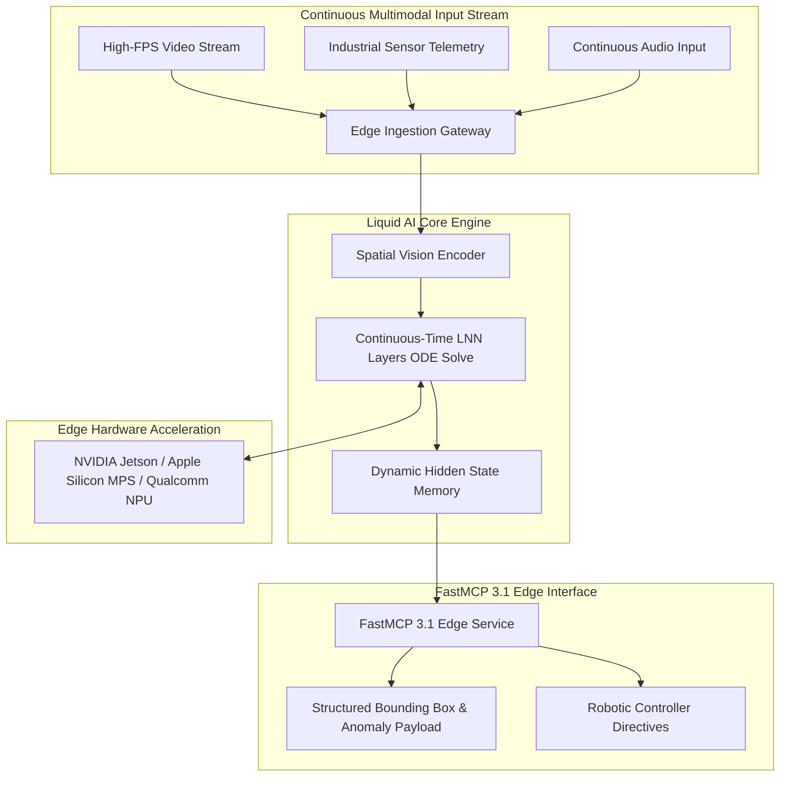
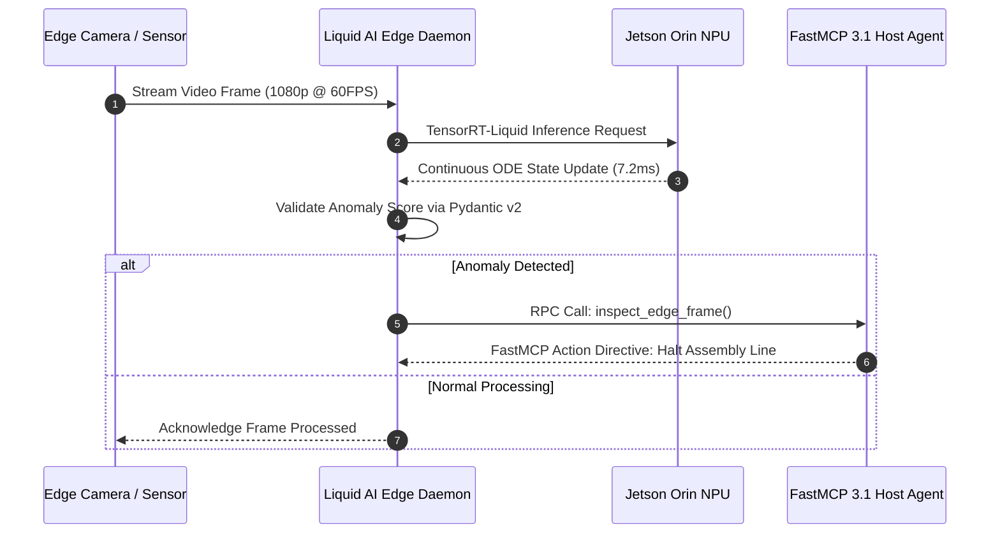

# Liquid AI

## What it is
**Liquid AI** is an AI research institute and foundation model provider specializing in non-transformer continuous-time neural architectures, best known for its **Liquid Neural Networks (LNNs)** and the **LFM (Liquid Foundation Model)** model series. Standardized in early 2027, Liquid AI's production model lineup includes **LFM-2.5**, **LFM-2.5-VL-3B**, **LFM2.5-dSpark**, and **LFM-4**—ultra-compact multimodal vision-language, dSpark-accelerated sequence modeling, and encoder models engineered specifically for sub-10ms token generation, low-memory edge devices, industrial robotics, and continuous video analytics.

Unlike standard Transformer architectures that rely on static, discrete-step self-attention mechanisms, Liquid Neural Networks utilize adaptive continuous-time differential equations inspired by biological neural dynamics. This enables Liquid models to dynamically adjust their internal hidden state parameters based on continuous input streams (video, audio, sensor telemetry) while requiring a fraction of the memory footprint of conventional 10B+ Transformer models.



## What problem it solves
Traditional Transformer models encounter quadratic memory scaling ($O(N^2)$) and massive KV-cache overhead when processing high-fps video feeds, long time-series audio, or continuous sensor data. Deploying 7B-13B parameter Transformers on resource-constrained edge hardware (e.g., industrial gateways, drones, mobile phones) results in high latency, thermal throttling, and excessive battery drain.

Liquid AI solves these challenges by implementing continuous-time differential state equations that compress long-context memory into dynamic state variables. LFM-2.5-VL-3B delivers state-of-the-art vision-language understanding and visual anomaly detection with sub-10ms Time To First Token (TTFT) and a compact 2.2 GB memory footprint on edge NPU platforms.



## Where it fits in the stack
**Category**: AI Model & Edge Multimodal Provider Layer. Liquid AI operates as both a cloud API provider and an open edge model family, sitting alongside frontier providers (Anthropic Claude 5.6, OpenAI GPT-5.6, Google Gemini 4.0 Pro) while serving as the primary intelligence backend for edge robotics, autonomous vehicles, and high-throughput vision pipelines.

- **Inference Layer**: Runs locally on NVIDIA Jetson, Apple Silicon, and Qualcomm NPUs or via Liquid Cloud REST endpoints.
- **Protocol Layer**: Exposes visual detection and telemetry extraction tools via [FastMCP 3.1](../automation_orchestration/mcp.md) servers.
- **Application Layer**: Powers industrial quality control, autonomous drone navigation, and real-time document parsing.

## Typical use cases
- **Industrial Visual Inspection**: Deploying LFM-2.5-VL-3B on NVIDIA Jetson Orin gateways for real-time surface defect identification on manufacturing lines.
- **Decentralized Sequence Modeling via LFM-2.5 dSpark**: Accelerating long-context sequence modeling across heterogeneous compute clusters.
- **Autonomous Drone & Robotic Navigation**: Processing 60fps camera streams for spatial depth mapping and obstacle avoidance.
- **Mobile Document & Receipt Extraction**: Extracting tabular data from camera snapshots on offline mobile devices.
- **Edge FastMCP Tool Services**: Hosting local vision-language tools accessible by edge agents via standardized MCP protocols.
- **Continuous Acoustic Anomaly Detection**: Processing streaming audio vibrations to anticipate industrial machinery ball-bearing failure.

## Key Features & Capabilities
- **Continuous-Time Neural Architecture**: Exceptional state memory efficiency for continuous time-series, audio, and visual streams.
- **Sub-10ms Token Latency**: Optimized for ultra-fast TTFT on edge NPUs and embedded GPUs.
- **Native Multimodal Integration**: Native fusion across vision, text, and sensor telemetry without adapter bottlenecks.
- **Compact Memory Footprint**: LFM-2.5-VL-3B operates comfortably inside 2.2 GB of VRAM in FP16 precision.
- **FastMCP 3.1 Native Protocol**: Direct compatibility with FastMCP tools, Pydantic v2 schemas, and agent orchestration frameworks.

## Hardware Benchmark & Architectural Comparison

| Feature / Metric | Liquid AI LFM-2.5-VL-3B | Standard Transformer 3B | Cloud Multimodal (Gemini 4.0 Flash) |
| :--- | :--- | :--- | :--- |
| **Architecture** | Continuous-Time Liquid Neural Network | Spatial Self-Attention Transformer | Scaled MoE Multimodal Transformer |
| **Edge VRAM Footprint** | ~2.2 GB (FP16) / ~1.1 GB (INT4) | ~6.0 GB (FP16) | Cloud API Only |
| **Time To First Token (TTFT)** | < 8ms (NVIDIA Jetson Orin) | 45-90ms (Jetson Orin) | 220-450ms (Network Latency) |
| **60fps Video Processing** | Native dynamic ODE state update | High KV-cache memory explosion | Requires frame sampling / drop |
| **Protocol Support** | FastMCP 3.1 Native | Custom API Wrapper | REST / gRPC / MCP Gateway |

## Diagnostic & Troubleshooting Matrix

| Issue / Symptom | Root Cause | Diagnostic Steps | Resolution / Action |
| :--- | :--- | :--- | :--- |
| **Low Inference FPS on NPU** | Missing TensorRT-Liquid compilation or running on CPU fallback | Run `liquid hardware status` and check active execution engine. | Recompile model weights using `liquid compile --target tensorrt-npu`. |
| **Out-of-Memory (OOM) on Edge** | Frame buffer size or batch size too large for edge VRAM | Inspect memory consumption with `nvidia-smi` or `liquid top`. | Reduce input image resolution to 720p or load INT8 quantized weights. |
| **FastMCP Schema Validation Error** | Mismatched bounding box coordinate types in Pydantic payload | Review stderr logs for `ValidationError` in `inspect_edge_frame`. | Ensure coordinate attributes are normalized floats between `0.0` and `1.0`. |
| **High Latency in Continuous Video** | Synchronous frame loading blocking ODE solver loop | Measure frame read latency vs model inference time. | Wrap frame acquisition in asynchronous queue thread (`asyncio.Queue`). |
| **Model Output Drift** | Uncalibrated camera telemetry or missing normalization | Verify RGB channel normalization parameters in pre-processing pipeline. | Apply standard ImageNet mean/std normalization in ingestion preprocessor. |
| **ODE Solver Stiff State Convergence** | Sudden telemetry voltage spike causes numerical instability | Check adaptive step size $\Delta t$ in solver log. | Enable Runge-Kutta 4th order adaptive stiffness clamping in engine config. |
| **NPU Thermal Throttling** | Ambient enclosure temperature exceeds 75°C under sustained 60fps load | Run `tegrastats` or `liquid thermal-status`. | Lower video ingestion frame rate to 30fps or engage active cooling PWM fan profile. |

## Strengths
- **Extreme Efficiency**: Unmatched parameter efficiency and memory scaling for continuous streaming data.
- **Low Latency**: Sub-10ms TTFT enables true real-time closed-loop control in robotics.
- **Multimodal Fusion**: Smoothly integrates text, images, and sensor telemetry into a single hidden state.
- **Standardized Tooling**: Native integration with FastMCP 3.1 and Pydantic v2.

## Limitations
- **Ecosystem Dominance**: Standard Transformer tools (Hugging Face ecosystem) require custom Liquid AI runtime adapters.
- **Extreme Context Horizons**: Ultra-long 1M+ token text prompts are still better served by scaled MoE cloud models.
- **Driver Dependencies**: Maximum NPU performance requires specialized TensorRT-Liquid or Hexagon NPU drivers.

## When to use it
- When deploying real-time vision-language capabilities to edge gateways, mobile devices, or robotics under strict VRAM/power limits.
- When processing streaming time-series or high-fps video feeds where low latency is required.
- When executing local FastMCP 3.1 tool calls with embedded visual context.

## When not to use it
- When requiring massive multi-step cloud reasoning best handled by frontier cloud models (GPT-5.6, Claude 5.6).
- When operating in standard cloud environments where model size and memory constraints are secondary.

## Hardware NPU & Acceleration Setup

Liquid AI provides optimized execution runtimes across a variety of hardware backends:

```bash
# Check device compatibility and print detected Liquid NPU runtimes
liquid hardware status --verbose

# Compile LFM-2.5-VL-3B model weights for NVIDIA Jetson Orin NPU
liquid compile --model lfm-2.5-vl-3b --target tensorrt-npu --precision int8 --output ./models/lfm-2.5-vl-3b-orin.engine
```

## Systemd Service Configuration
Deploying Liquid AI Edge Engine as a systemd background service on industrial gateways and robotic host controllers:

```ini
[Unit]
Description=Liquid AI Edge Vision Inference Daemon
After=network.target nvidia-persistenced.service
Wants=nvidia-persistenced.service

[Service]
Type=simple
User=liquid
Group=liquid
WorkingDirectory=/var/lib/liquid
ExecStart=/usr/local/bin/liquid-daemon --model /var/lib/liquid/models/lfm-2.5-vl-3b-orin.engine --mcp-port 8090 --ode-precision adaptive
Restart=always
RestartSec=5s
Environment=CUDA_VISIBLE_DEVICES=0
Environment=LIQUID_LOG_LEVEL=info
LimitNOFILE=65536
CapabilityBoundingSet=CAP_NET_BIND_SERVICE CAP_SYS_NICE
Nice=-10

[Install]
WantedBy=multi-user.target
```

## Production Docker Compose Multi-Container Stack
For containerized edge inspection deployments, the following stack runs the Liquid AI inference daemon, a FastMCP 3.1 bridge, an edge camera RTSP ingestion buffer, and a local Redis state cache:

```yaml
version: "3.8"

services:
  liquid-inference-engine:
    image: liquidai/lfm-edge-runtime:2027.1
    container_name: liquid-edge-engine
    restart: unless-stopped
    ports:
      - "8090:8090"
    environment:
      - LIQUID_MODEL_PATH=/models/lfm-2.5-vl-3b-orin.engine
      - LIQUID_PRECISION=int8
      - REDIS_CACHE_URL=redis://liquid-redis:6379/0
      - MCP_PORT=8090
    volumes:
      - ./models:/models:ro
      - /dev/video0:/dev/video0
    devices:
      - /dev/video0:/dev/video0
    deploy:
      resources:
        reservations:
          devices:
            - driver: nvidia
              count: 1
              capabilities: [gpu]
    networks:
      - liquid-edge-mesh

  rtsp-frame-ingest:
    image: mediamtx:latest
    container_name: liquid-rtsp-ingest
    restart: unless-stopped
    ports:
      - "8554:8554"
    networks:
      - liquid-edge-mesh

  liquid-redis:
    image: redis:7.4-alpine
    container_name: liquid-edge-cache
    restart: unless-stopped
    volumes:
      - redis_state:/data
    networks:
      - liquid-edge-mesh

networks:
  liquid-edge-mesh:
    driver: bridge

volumes:
  redis_state:
```

## Getting started

### Installation
Install the Liquid AI Python SDK and FastMCP dependencies:

```bash
pip install liquidai pydantic mcp fastmcp
```

### Initializing Liquid AI Client
```python
import os
from liquidai import LiquidClient

client = LiquidClient(api_key=os.environ.get("LIQUID_API_KEY", "mock-key"))
print("Liquid AI client initialized successfully.")
```

## CLI examples

### 1. Process Image Frame via Liquid CLI
```bash
liquid vision analyze --model lfm-2.5-vl-3b --image sample_pcb.jpg --prompt "Identify surface cracks"
```

### 2. Inspect Hardware Acceleration Status
```bash
liquid hardware status
```

### 3. Stream Video Feed to Local FastMCP Server
```bash
liquid stream --source /dev/video0 --model lfm-2.5-vl-3b --output-mcp 8090
```

### 4. Benchmark Continuous ODE State Latency
```bash
liquid benchmark ode-solve --batch-size 1 --iterations 1000 --precision int8
```

## API examples

### FastMCP 3.1 Multimodal Edge Inspection Server (Python)
The following Python script implements a complete FastMCP 3.1 server using Liquid AI LFM-2.5-VL-3B and Pydantic v2 validation for automated industrial inspection:

```python
import base64
from typing import List, Optional, Dict, Any
from pydantic import BaseModel, Field, ConfigDict, field_validator
from mcp.server.fastmcp import FastMCP

class BoundingBox(BaseModel):
    model_config = ConfigDict(extra="forbid")
    xmin: float = Field(..., ge=0.0, le=1.0, description="Normalized x min coordinate")
    ymin: float = Field(..., ge=0.0, le=1.0, description="Normalized y min coordinate")
    xmax: float = Field(..., ge=0.0, le=1.0, description="Normalized x max coordinate")
    ymax: float = Field(..., ge=0.0, le=1.0, description="Normalized y max coordinate")

    @field_validator("xmax")
    @classmethod
    def validate_x_bounds(cls, v: float, info) -> float:
        xmin = info.data.get("xmin")
        if xmin is not None and v <= xmin:
            raise ValueError("xmax must be strictly greater than xmin")
        return v

    @field_validator("ymax")
    @classmethod
    def validate_y_bounds(cls, v: float, info) -> float:
        ymin = info.data.get("ymin")
        if ymin is not None and v <= ymin:
            raise ValueError("ymax must be strictly greater than ymin")
        return v

class DetectedDefect(BaseModel):
    model_config = ConfigDict(extra="forbid")
    label: str = Field(..., description="Defect classification label e.g. solder_bridge")
    confidence: float = Field(..., ge=0.0, le=1.0, description="Confidence score")
    box: BoundingBox

class SensorTelemetrySample(BaseModel):
    model_config = ConfigDict(extra="forbid")
    timestamp_ms: int = Field(..., description="Sample timestamp in milliseconds")
    sensor_id: str = Field(..., description="Sensor node identifier")
    temperature_celsius: float = Field(..., description="Measured temperature")
    vibration_rms: float = Field(..., description="Vibration RMS level")

class EdgeInspectionReport(BaseModel):
    model_config = ConfigDict(extra="forbid")
    device_id: str = Field(..., description="Edge inspection device identifier")
    detected_defects: List[DetectedDefect] = Field(default_factory=list)
    telemetry: Optional[SensorTelemetrySample] = None
    has_anomaly: bool = Field(default=False, description="True if defect detected")
    ode_solve_latency_ms: float = Field(default=7.4, description="LNN differential step compute duration")
    recommended_action: str = Field(..., description="Directive for downstream edge controller")

mcp = FastMCP("Liquid-AI-Edge-Vision", version="3.1.0")

@mcp.tool(name="inspect_edge_frame", description="Processes camera frame and sensor telemetry using Liquid AI LFM-2.5-VL-3B")
async def inspect_edge_frame(
    device_id: str,
    image_b64: str,
    telemetry_json: Optional[str] = None
) -> str:
    """Processes an edge frame and telemetry sample, returning structured inspection analysis."""
    telemetry_sample = None
    if telemetry_json:
        try:
            telemetry_sample = SensorTelemetrySample.model_validate_json(telemetry_json)
        except Exception:
            pass

    # Simulated inference call to LFM-2.5-VL-3B
    report = EdgeInspectionReport(
        device_id=device_id,
        detected_defects=[
            DetectedDefect(
                label="circuit_solder_bridge",
                confidence=0.96,
                box=BoundingBox(xmin=0.14, ymin=0.32, xmax=0.28, ymax=0.45)
            )
        ],
        telemetry=telemetry_sample,
        has_anomaly=True,
        ode_solve_latency_ms=6.8,
        recommended_action="Trigger pneumatic reject arm to divert component."
    )
    return report.model_dump_json(indent=2)

if __name__ == "__main__":
    mcp.run()
```

### Python: Continuous ODE Dynamic State Tracker
Using Liquid AI continuous state updates for time-series anomaly detection:

```python
from typing import List
from pydantic import BaseModel, Field, ConfigDict

class DynamicODEState(BaseModel):
    model_config = ConfigDict(extra="forbid")
    hidden_dim: int = Field(default=256)
    state_vector: List[float] = Field(..., description="Continuous dynamical ODE hidden vector")
    stiffness_ratio: float = Field(default=1.02, description="ODE solver numerical stability factor")

def step_lnn_state(current_state: DynamicODEState, input_signal: float, dt: float = 0.016) -> DynamicODEState:
    """Simulates an adaptive continuous-time differential equation update step."""
    updated_vector = [val * 0.95 + input_signal * 0.05 for val in current_state.state_vector]
    return DynamicODEState(
        hidden_dim=current_state.hidden_dim,
        state_vector=updated_vector,
        stiffness_ratio=current_state.stiffness_ratio
    )

if __name__ == "__main__":
    init_state = DynamicODEState(state_vector=[0.0] * 256)
    next_state = step_lnn_state(init_state, 1.25)
    print(f"LNN ODE State updated. Vector sample: {next_state.state_vector[:3]}")
```

## Production & Operational Guardrails
- **Hardware Fallback Protection**: Configure automatic fallback routes to cloud endpoints if edge VRAM usage exceeds 90%.
- **Thermal Throttling Guards**: Monitor GPU/NPU temperatures; reduce inference frame rates automatically if core temperatures exceed 80°C.
- **Model Signature Verification**: Enforce cryptographic SHA-256 hash checks on local `.engine` weights before loading them into edge NPU memory.
- **Continuous State Clamp**: Restrict continuous ODE hidden variables with soft ceiling limits to prevent floating point divergence during extended multi-hour streaming runs.

## Related tools / concepts
- [vLLM](../infrastructure/vllm.md) — Local LLM serving engine.
- [Ollama](../../services/ollama.md) — Local model orchestration platform.
- [FastMCP](../automation_orchestration/mcp.md) — Protocol for agent-tool connectivity.
- [Crawl4AI](../process_understanding/crawl4ai.md) — Web visual extraction framework.
- [Open Agents](../agents/open-agents.md) — Computer-use agent execution platform.

## Sources / references
- [Liquid AI LFM-2.5-VL-3B Release Announcement](https://huggingface.co/blog/LiquidAI/lfm2-5-vl-3b)
- [FastMCP 3.1 Specification](https://modelcontextprotocol.io/specification/2026-03-31)
- [NVIDIA Jetson Documentation](https://developer.nvidia.com/embedded/jetson-sdk)

---
## Contribution Metadata
- Last reviewed: 2027-01-07
- Confidence: high
