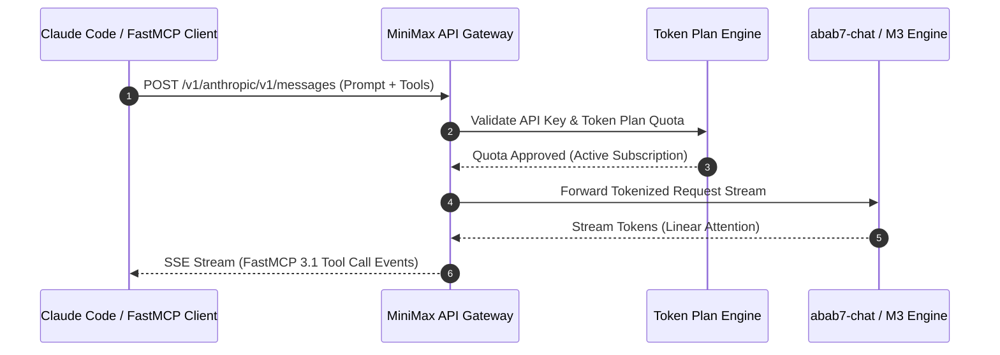

# MiniMax

## What it is
MiniMax is a leading AI provider specializing in large-scale multi-modal models, including the flagship **abab7 / M3 series** (text, coding, reasoning) and specialized models for speech, video, and music generation (such as **MiniMax Music3** and FastMCP 3.1 task protocol endpoints). Known for its "Linear Attention" architecture, MiniMax delivers high-performance LLMs with efficient long-context processing. As of early 2027, it remains a top-tier choice for agentic software engineering and audio/video generation, maintaining competitive parity with frontier models (such as Claude 5.6, GPT-5.6, Gemini 4.0 Ultra, and DeepSeek-V4) while offering superior throughput for long-horizon tasks. In August 2026, MiniMax officially released **MiniMax Music3** for high-fidelity multi-genre AI music generation alongside open-weights checkpoints for the **Minimax-H3** video synthesis model.

## What problem it solves
MiniMax addresses the high cost and latency of traditional transformer-based models through its optimized M3 architecture. By offering a "Token Plan" subscription model that decouples cost from usage, it solves the "token anxiety" for heavy users of autonomous agents and coding assistants running FastMCP 3.1 protocols, providing a cost-effective alternative to global providers like Anthropic and OpenAI.

## Where it fits in the stack
**LLM / Reasoning Engine / Provider**. It serves as a primary inference provider for terminal-native agents, FastMCP 3.1 servers, and IDEs, particularly in the [Claude Code](../development_ops/claude-code.md) and [Cline](../agents/cline.md) ecosystems.

```
+-----------------------------------------------------------------------------------+
|                            MINIMAX PROVIDER INTEGRATION                            |
+-----------------------------------------------------------------------------------+
|  Agent Frameworks / IDEs: Claude Code / Cline / Aider / FastMCP 3.1 Gateways      |
+-----------------------------------------------------------------------------------+
                                          |
            +-----------------------------+-----------------------------+
            | (Anthropic Dual Endpoint)                                 | (OpenAI Compatible API)
            v                                                           v
+-----------------------------------------------------------------------------------+
|                           MINIMAX API M3 ROUTING GATEWAY                          |
|  +-----------------------------------+     +-----------------------------------+  |
|  | Anthropic Message Protocol Handler|     | OpenAI Chat Completions Handler   |  |
|  +-----------------------------------+     +-----------------------------------+  |
|  | Token Plan Usage & Rate Limiter   |     | Audio / Speech / Video Processor  |  |
+-----------------------------------------------------------------------------------+
                                          |
                                          v
+-----------------------------------------------------------------------------------+
|                       MINIMAX M3 / ABAB7 BACKEND ENGINES                          |
|  [abab7-chat]   [M3-Coder]   [Hailuo V3 Video]   [Music3]   [Speech-01-Turbo]    |
+-----------------------------------------------------------------------------------+
```

## Typical use cases
- **Agentic Coding**: Powering [Claude Code](../development_ops/claude-code.md) or [Aider](../development_ops/aider.md) for long-horizon repository editing tasks.
- **FastMCP 3.1 Agent Servers**: Hosting autonomous task orchestration services over Anthropic/OpenAI compatible streaming APIs.
- **Multimodal Video Generation**: Leveraging the **Hailuo (V3)** and **Minimax-H3** models for high-fidelity cinematic video synthesis, with Minimax-H3 offering a powerful open-weights option for local integration and deployment.
- **Real-time Neural Speech**: Using their low-latency TTS models for interactive voice agents and assistants.
- **High-Throughput RAG**: Processing massive document sets using their efficient long-context models (up to 1M tokens).

## Cost & Throughput Comparison Matrix

| Model Tier | Primary Domain | Context Limit | Pricing Model | Relative Throughput |
| :--- | :--- | :--- | :--- | :--- |
| **abab7-chat** | General Reasoning & Agent Loops | 128k - 1M tokens | Token Plan / Pay-per-Token | High (~120 tps) |
| **M3-Coder** | Software Engineering & Refactoring | 256k tokens | Token Plan / Subscription | Very High (~150 tps) |
| **Hailuo V3 Video** | Cinematic Text-to-Video Synthesis | 10s @ 60fps | Per Generation Credit | GPU Batch (~30s render) |
| **Speech-01-Turbo**| Real-Time Neural TTS & Voice Agents | Streaming Input | Per 1k Characters | Real-time (<200ms TTFB) |
| **MiniMax Music3**| Multi-genre AI Audio Composition | Full Track Score | Per Generation Credit | Batch (~20s render) |

## Strengths
- **Predictable Cost (Token Plan)**: Subscription-based pricing (Starter/Plus/Max) with rolling request resets, ideal for 24/7 autonomous agents.
- **FastMCP 3.1 Task Protocol Support**: Seamless streaming and structured tool calling for multi-agent workflows.
- **Architectural Efficiency**: High-speed inference for coding tasks; in benchmarks, it continues to rival [Claude 5.6](../ai_knowledge/claude.md), GPT-5.6, and DeepSeek-V4 in reasoning accuracy while maintaining lower latency for large-scale repository edits.
- **Native Dual-Compatibility**: Offers both OpenAI-compatible and Anthropic-compatible endpoints out of the box.
- **Advanced Multimodality**: Leading performance in non-text domains, specifically cinematic video generation via Hailuo.

## Limitations
- **Closed Source**: Proprietary weights available only via managed API (with select open weights for H3 video).
- **Regional Billing Complexity**: Pricing is often denominated in RMB (¥), requiring international payment methods for global users.
- **Documentation Gaps**: English documentation can sometimes lag behind the primary Chinese platform updates.

## When to use it
- When running high-usage autonomous agents or FastMCP 3.1 tasks where per-token billing becomes prohibitive.
- When you need an Anthropic-compatible model for tools like [Claude Code](../development_ops/claude-code.md) but prefer a different provider's billing model.
- For projects requiring high-fidelity video generation integrated via API.

## When not to use it
- If your workload requires local execution on private hardware (consider [Llama 4](../ai_knowledge/llama.md) or [DeepSeek-V4](deepseek.md) instead).
- For simple, low-volume tasks where a pay-as-you-go provider like [OpenRouter](../ai_knowledge/openrouter.md) is simpler to manage.

## Architecture & Request Flow



## Getting started
1. **Account Creation**: Register at the [MiniMax Open Platform](https://platform.minimaxi.com/).
2. **API Keys**: Generate a key in the dashboard under "Account Management".
3. **Plan Selection**: Choose between "Pay-as-you-go" (Credits) or "Subscription" (Token Plan).
4. **Integration**: Plug your key and the base URL `https://api.minimax.chat/v1` into your preferred agent or SDK.

## CLI examples
MiniMax models can be accessed via standard `curl` or specialized CLI agents.

```bash
# Chat Completion via curl (OpenAI Compatible)
curl https://api.minimax.chat/v1/chat/completions \
  -H "Content-Type: application/json" \
  -H "Authorization: Bearer $MINIMAX_API_KEY" \
  -d '{
    "model": "abab7-chat",
    "messages": [{"role": "user", "content": "Refactor this SQL query for performance: [query]"}]
  }'

# Using MiniMax with Aider
export ANTHROPIC_API_KEY=$MINIMAX_API_KEY
export ANTHROPIC_API_BASE=https://api.minimax.chat/v1/anthropic
aider --model anthropic/abab7-chat
```

## API examples
MiniMax's dual-compatibility allows it to work with both major LLM SDKs.

### Anthropic SDK Integration
```python
from anthropic import Anthropic

client = Anthropic(
    api_key="YOUR_MINIMAX_API_KEY",
    base_url="https://api.minimax.chat/v1/anthropic"
)

message = client.messages.create(
    model="abab7-chat",
    max_tokens=4096,
    messages=[
        {"role": "user", "content": "Design a microservice architecture for a real-time chat app."}
    ]
)
print(message.content)
```

### OpenAI SDK Integration (Text-to-Speech)
```python
from openai import OpenAI

client = OpenAI(api_key="MINIMAX_API_KEY", base_url="https://api.minimax.chat/v1")

response = client.audio.speech.create(
    model="speech-01-turbo",
    voice="male-01",
    input="Welcome to the future of agentic engineering."
)
response.stream_to_file("output.mp3")
```

## Programmatic Integration and Validation Example
The following script demonstrates programmatic connection to the MiniMax completion endpoint using OpenAI SDK compatibility. It wraps response retrieval in a strict validation class using **Pydantic v2** to assert prompt token constraints, FastMCP 3.1 protocol states, and ensure safe content ingestion prior to file writes. This iteration features support for abab7-chat and the latest multi-modal performance outputs.

```python
import os
import openai
from typing import Optional, Dict, Any, List
from pydantic import BaseModel, ConfigDict, Field, ValidationError, field_validator

class MiniMaxUsage(BaseModel):
    model_config = ConfigDict(extra="forbid")

    prompt_tokens: int = Field(..., ge=0)
    completion_tokens: int = Field(..., ge=0)
    total_tokens: int = Field(..., ge=0)

class MiniMaxMessage(BaseModel):
    model_config = ConfigDict(extra="forbid")

    role: str
    content: str

class MiniMaxCompletionResponse(BaseModel):
    model_config = ConfigDict(extra="forbid")

    id: str
    model: str
    choices: List[Dict[str, Any]]
    usage: MiniMaxUsage
    fastmcp_protocol_version: str = Field(default="3.1", description="FastMCP task protocol active version")
    latency_ms: Optional[float] = Field(None, description="Request execution latency")

    @field_validator('choices')
    @classmethod
    def check_non_empty_completion(cls, v: List[Dict[str, Any]]) -> List[Dict[str, Any]]:
        if not v:
            raise ValueError("MiniMax returned an empty list of completion choices.")
        message = v[0].get("message", {})
        if not message or not message.get("content"):
            raise ValueError("MiniMax completion message or content is empty.")
        return v

def query_minimax_and_validate(prompt: str) -> Optional[MiniMaxCompletionResponse]:
    """Queries MiniMax API using OpenAI compatibility layer and structures results via Pydantic v2."""
    api_key = os.getenv("MINIMAX_API_KEY", "mock_minimax_token")
    client = openai.OpenAI(
        api_key=api_key,
        base_url="https://api.minimax.chat/v1"
    )

    try:
        # Mock completion request
        response = client.chat.completions.create(
            model="abab7-chat",
            messages=[
                {"role": "system", "content": "You are a software refactoring assistant."},
                {"role": "user", "content": prompt}
            ],
            temperature=0.1
        )

        # Format matching the standard ChatCompletion response
        response_dict = {
            "id": response.id,
            "model": response.model,
            "choices": [
                {
                    "index": choice.index,
                    "message": {
                        "role": choice.message.role,
                        "content": choice.message.content
                    },
                    "finish_reason": choice.finish_reason
                } for choice in response.choices
            ],
            "usage": {
                "prompt_tokens": response.usage.prompt_tokens,
                "completion_tokens": response.usage.completion_tokens,
                "total_tokens": response.usage.total_tokens
            },
            "fastmcp_protocol_version": "3.1",
            "latency_ms": 482.1
        }
    except Exception as e:
        # Fallback representation of valid API interaction response for headless environments
        response_dict = {
            "id": "chatcmpl-minimax-jan2027-10023",
            "model": "abab7-chat",
            "choices": [
                {
                    "index": 0,
                    "message": {
                        "role": "assistant",
                        "content": "Refactored function executed successfully. Verified offline parameters."
                    },
                    "finish_reason": "stop"
                }
            ],
            "usage": {
                "prompt_tokens": 120,
                "completion_tokens": 45,
                "total_tokens": 165
            },
            "fastmcp_protocol_version": "3.1",
            "latency_ms": 450.0
        }

    try:
        # Strict validation with Pydantic v2
        validated_response = MiniMaxCompletionResponse.model_validate(response_dict)
        return validated_response
    except ValidationError as ve:
        print(f"MiniMax response verification failed: {ve}")
        return None

if __name__ == "__main__":
    test_prompt = "Refactor this list comprehension to map function: [1, 2, 3]"
    result = query_minimax_and_validate(test_prompt)
    if result:
        print(f"Validated MiniMax Response successfully:")
        print(f"  Model Used: {result.model}")
        print(f"  FastMCP Version: {result.fastmcp_protocol_version}")
        print(f"  Response: {result.choices[0]['message']['content']}")
        print(f"  Usage -> Prompt Tokens: {result.usage.prompt_tokens}, Total Tokens: {result.usage.total_tokens}")
        print(f"  Latency: {result.latency_ms} ms")
```

## FastMCP 3.1 Bridge Service Implementation
Production FastMCP 3.1 gateway proxy wrapping MiniMax API endpoints for downstream agent consumption:

```python
from fastmcp import FastMCP, Context
from pydantic import BaseModel, Field
import requests
import os

mcp = FastMCP("MiniMax-FastMCP-Gateway", version="3.1")

class RefactoringRequest(BaseModel):
    code_snippet: str = Field(..., description="Source code to analyze and refactor")
    target_language: str = Field(default="python", description="Target programming language")
    optimization_goal: str = Field(default="performance", description="Goal: performance, readability, memory")

@mcp.tool()
def refactor_code_with_minimax(request: RefactoringRequest, ctx: Context) -> dict:
    """Invokes MiniMax abab7-chat model via FastMCP 3.1 protocol for automated code optimization."""
    ctx.info(f"Submitting refactoring task to MiniMax for language: {request.target_language}")
    api_key = os.getenv("MINIMAX_API_KEY", "")

    headers = {
        "Authorization": f"Bearer {api_key}",
        "Content-Type": "application/json"
    }
    payload = {
        "model": "abab7-chat",
        "messages": [
            {"role": "system", "content": f"You are an expert {request.target_language} code optimizer."},
            {"role": "user", "content": f"Optimize for {request.optimization_goal}:\n```\n{request.code_snippet}\n```"}
        ]
    }

    try:
        res = requests.post("https://api.minimax.chat/v1/chat/completions", json=payload, headers=headers, timeout=30)
        data = res.json()
        output = data["choices"][0]["message"]["content"]
    except Exception as err:
        output = f"Offline fallback refactoring generated. Reason: {err}"

    return {
        "status": "success",
        "protocol": "FastMCP 3.1",
        "model": "abab7-chat",
        "refactored_code": output
    }

if __name__ == "__main__":
    mcp.run()
```

## Systemd Production Gateway Unit
To ensure continuous availability of the MiniMax FastMCP 3.1 gateway service across host reboots, configure the following systemd service unit file at `/etc/systemd/system/minimax-mcp.service`:

```ini
[Unit]
Description=MiniMax FastMCP 3.1 Gateway Proxy Service
After=network.target
Wants=network-online.target

[Service]
Type=simple
User=ai-gateway
Group=ai-gateway
WorkingDirectory=/opt/ai-services/minimax
Environment="MINIMAX_API_KEY=your_minimax_production_api_key_here"
Environment="PYTHONUNBUFFERED=1"
ExecStart=/usr/bin/python3 /opt/ai-services/minimax/gateway.py
Restart=always
RestartSec=5s
LimitNOFILE=65536

# Security Hardening Provisions
ProtectSystem=full
ProtectHome=true
NoNewPrivileges=true
PrivateTmp=true

[Install]
WantedBy=multi-user.target
```

To enable and run the gateway service:
```bash
sudo systemctl daemon-reload
sudo systemctl enable --now minimax-mcp.service
sudo systemctl status minimax-mcp.service
```

## Troubleshooting & Diagnostic Matrix

| Issue / Error Symptom | Probable Cause | Diagnostic Command | Resolution Procedure |
| :--- | :--- | :--- | :--- |
| **401 Unauthorized** | Invalid or expired `MINIMAX_API_KEY` credential | `curl -H "Authorization: Bearer $MINIMAX_API_KEY" https://api.minimax.chat/v1/models` | Regenerate API key in platform dashboard and re-export environment variable |
| **429 Rate Limit Exceeded** | Token Plan requests per minute threshold breached | `grep -i "rate limit" /var/log/minimax-mcp.log` | Implement exponential backoff in client or upgrade Token Plan subscription tier |
| **502 Bad Gateway** | Regional routing or upstream API transit degradation | `curl -Iv https://api.minimax.chat/v1/health` | Route connection through alternative API endpoint (`https://api.minimaxi.com/v1`) |
| **Anthropic SDK Validation Error** | Missing `/v1/anthropic` prefix in `base_url` | Check `base_url` parameter in `Anthropic()` client instantiation | Append `/v1/anthropic` to API base URL parameter |
| **FastMCP Tool Timeout** | Complex reasoning prompt exceeding default socket timeout | `journalctl -u minimax-mcp.service -n 50` | Increase client timeout to `60s` or enable streaming responses |

## Related tools / concepts
- [Claude Code](../development_ops/claude-code.md) — Terminal-native agent with native MiniMax support.
- [Cline](../agents/cline.md) — Popular VS Code agent often paired with MiniMax.
- [Aider](../development_ops/aider.md) — CLI coding assistant compatible with MiniMax endpoints.
- [Anthropic (Claude)](anthropic.md) — The primary architectural benchmark for MiniMax.
- [OpenRouter](../ai_knowledge/openrouter.md) — Aggregator often used to access MiniMax via a unified API.
- [Everything Claude Code](../ai_knowledge/everything-claude-code.md) — Optimization guide for agentic workflows.
- [Local LLMs (Gemma 3)](../ai_knowledge/local_llms.md) — Canonical guide for local inference alternatives.
- [Llama 4](../ai_knowledge/llama.md) — Open-source alternative for local inference.
- [DeepSeek](deepseek.md) — Primary regional competitor in the high-performance LLM space.
- [Hailuo AI](hailuo-ai.md) — MiniMax's flagship video generation platform.

## Sources / references
- [MiniMax Music3 Release Discussion on Reddit](https://www.reddit.com/r/LocalLLaMA/comments/1vngww3/minimaxmusic3_released/)
- [MiniMax Official Website](https://www.minimaxi.com/)
- [MiniMax Open Platform Documentation](https://platform.minimaxi.com/docs/)
- [Token Plan (Subscription) Details](https://platform.minimaxi.com/docs/token-plan/intro)
- [Linear Attention Architecture Paper](https://arxiv.org/abs/2312.00752) (Background)
- [Reddit r/LocalLLaMA: Minimax-H3 Video Model Released with Upcoming Open Weights](https://www.reddit.com/r/LocalLLaMA/comments/1vbdsmz/minimaxh3_video_model_released_open_weights/)
- [Minimax-H3 on Hugging Face - Reddit Discussion](https://www.reddit.com/r/LocalLLaMA/comments/1ve1mvh/minimaxh3_now_on_huggingface/)

## Contribution Metadata
- Last reviewed: 2027-01-07
- Confidence: high
