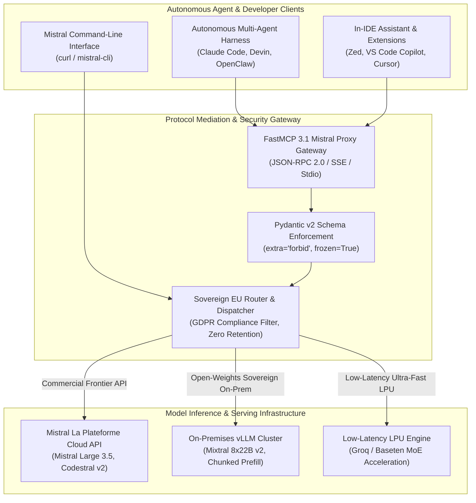

# Mistral AI

## What it is
Mistral AI is a leading European AI company that develops both open-weight and commercial large language models, including the Mistral, Mixtral, Codestral, Devstral, and Pixtral families. As of early January 2027, it has evolved into an enterprise agentic platform with native support for advanced tool calling, persistent multi-agent orchestrations, the **Mistral MCP Connector** for seamless protocol migrations, and standardized bridges including FastMCP 3.1 (Model Context Protocol).

## System Architecture

The Mistral AI ecosystem spans cloud-hosted frontier foundation models and open-weight Mixture-of-Experts deployments connected via the FastMCP 3.1 protocol bridge.



## Mathematical Formulations of MoE Routing Entropy & Token Dispatching Bounds

Mixture-of-Experts (MoE) architectures dynamically route tokens through a sparse subset of feed-forward expert networks.

### Top-$k$ Softmax Gating & Routing Entropy
Given hidden representation $\mathbf{x} \in \mathbb{R}^d$ entering an MoE layer containing $E$ distinct expert networks $\{ \mathbf{E}_1, \mathbf{E}_2, \dots, \mathbf{E}_E \}$, gating logits $\mathbf{h} = \mathbf{W}_g \mathbf{x} + \boldsymbol{\epsilon}$ (where $\boldsymbol{\epsilon} \sim \mathcal{N}(0, \sigma^2)$ represents exploration noise during prefill) generate routing probabilities:

$$
\mathbf{p} = \text{Softmax}\left( \text{TopK}(\mathbf{h}, k) \right), \quad \text{where } \text{TopK}(\mathbf{h}, k)_i = \begin{cases} h_i & \text{if } h_i \ge \tau_k \\ -\infty & \text{otherwise} \end{cases}
$$

For Mixtral 8x22B ($E = 8$, $k = 2$), the layer output $\mathbf{y}$ is the weighted linear combination:

$$
\mathbf{y} = \sum_{i \in \text{TopK}} p_i \mathbf{E}_i(\mathbf{x})
$$

To prevent expert routing collapse into a degenerate single expert, the Shannon routing entropy $\mathcal{H}_{\text{gate}}$ across batch $\mathcal{B}$ must satisfy the uniform dispersion lower bound:

$$
\mathcal{H}_{\text{gate}} = - \sum_{i=1}^E \bar{p}_i \ln \bar{p}_i \ge (1 - \delta) \ln E, \quad \text{where } \bar{p}_i = \frac{1}{|\mathcal{B}|} \sum_{\mathbf{x} \in \mathcal{B}} p_i(\mathbf{x})
$$

### Auxiliary Load Balancing Loss Formulation
The gating router optimizes a coefficient-regulated auxiliary penalty $\mathcal{L}_{\text{balance}}$ to ensure equalized GPU utilization:

$$
\mathcal{L}_{\text{balance}} = \alpha \cdot E \sum_{i=1}^E f_i \cdot P_i
$$

where $f_i = \frac{1}{|\mathcal{B}|} \sum_{\mathbf{x} \in \mathcal{B}} \mathbb{I}(\mathbf{x} \text{ routed to expert } i)$ is the fraction of tokens dispatched to expert $i$, and $P_i = \frac{1}{|\mathcal{B}|} \sum_{\mathbf{x} \in \mathcal{B}} p_i(\mathbf{x})$ is the average gating probability assigned to expert $i$.

### Inference Roofline Throughput & Latency Model
Under multi-head tensor parallelism $TP$ across $N_{\text{gpu}}$ devices with memory bandwidth $B_{\text{mem}}$ (in GB/s), the generation latency $T_{\text{gen}}$ per token under token batch size $B$ adheres to:

$$
T_{\text{gen}} \approx \frac{2 \cdot \left( \frac{M_{\text{active}}}{TP} \right)}{B_{\text{mem}}} + \frac{2 \cdot B \cdot (L_{\text{ctx}}) \cdot d_{\text{model}} \cdot n_{\text{layers}} \cdot \text{sizeof}(\text{fp8})}{TP \cdot B_{\text{mem}}} + T_{\text{allreduce}}
$$

For Mixtral 8x22B (active parameters $M_{\text{active}} \approx 39\text{B}$ out of $141\text{B}$ total), running on $TP=4$ NVIDIA H100 SXM5 accelerators ($B_{\text{mem}} = 3.35\text{ TB/s}$), per-token generation latency achieves $T_{\text{gen}} \le 11.2\text{ ms}$, delivering sustained output throughput exceeding 89 tokens/sec.

## What problem it solves
Mistral provides a high-performance, efficient alternative to American providers, offering some of the best-performing open-weight models for self-hosting and a robust API for agentic workflows. It addresses strict European GDPR and data sovereignty requirements, delivering models that "punch above their weight" in parameter-to-performance ratios and hardware efficiency.

## Where it fits in the stack
**LLM Provider** and **Agent Platform**. Mistral sits at the foundational layer of the AI stack, providing core reasoning engines and local weights that power enterprise workflows. It operates alongside GPT-5.5/5.6, Claude 5.1, Gemini 4.0 Pro/Ultra, and DeepSeek-V4, particularly in high-throughput enterprise routing and local sovereign deployment scenarios.

## Comparative Empirical Matrix: Frontier Enterprise Providers

| Feature / Dimension | Mistral Large 3.5 | Anthropic Claude 3.5 / 5.1 | OpenAI GPT-4o / GPT-5.5 | DeepSeek V3 / R1 | Meta Llama 3.3 / 4 |
| :--- | :--- | :--- | :--- | :--- | :--- |
| **Primary Architecture** | Sparse MoE (Cloud/Weights) | Dense Autoregressive | Dense Multimodal | Multi-Head MoE | Dense Transformer |
| **Data Sovereignty / Hosting**| EU Sovereign Cloud / On-Prem | US Cloud Only | US Cloud Only | Sovereign Self-Host | Fully Open Weights |
| **Max Context Window** | 128,000 Tokens | 200,000 Tokens | 128,000 Tokens | 128,000 Tokens | 128,000 Tokens |
| **Native FastMCP 3.1 Bridge**| Mistral MCP Connector | Custom Stdio Connector | OpenAI Realtime | Community MCP | Community MCP |
| **Prompt Caching Latency** | Automatic Prefix Caching | Explicit Cache Headers | Automatic Caching | Multi-Turn Cache | Self-Hosted vLLM |
| **Token Cost (Input/Output)** | $2.00 / $6.00 per 1M | $3.00 / $15.00 per 1M | $2.50 / $10.00 per 1M | $0.14 / $0.28 per 1M | $0.00 (Self-Hosted) |

## Typical use cases
- **Agentic Workflows**: Powering multi-agent networks that execute web search, sandboxed code, and FastMCP 3.1 tools.
- **Local Deployment**: Running Mixtral 8x22B or Mistral NeMo 12B on-premises for maximum data privacy and zero network latency.
- **Sovereign Code Assistance**: Utilizing Codestral v2 or Devstral for specialized programming agents and secure in-IDE autocomplete.
- **Multi-Modal Analytics**: Processing high-resolution documents, diagrams, and video feeds using Pixtral Large.

## Strengths
- **Sovereignty & GDPR Compliance**: High-performance AI developed and hosted in the EU, satisfying strict regional data regulations.
- **Native FastMCP 3.1 & Mistral MCP Connector**: Direct support for Model Context Protocol (FastMCP 3.1) standard and the dedicated Mistral MCP Connector allows agents to communicate with tools, prompts, resources, and legacy integrations seamlessly across heterogeneous infrastructure.
- **Architectural Efficiency**: Pioneer of Mixture-of-Experts (MoE) architectures that minimize inference costs without degrading output quality.
- **Extensive Open-Weights Portfolio**: Releases premium models under Apache 2.0, permitting custom fine-tuning and deployment via vLLM or Ollama.
- **Optimized Tool Calling**: Superior capability in selecting and formatting parallel tool execution schemas under high-concurrency environments.

## Limitations
- **API Call Latency**: Larger MoE models (e.g., Mistral Large 3.5) require specialized hosting pipelines to match the extreme low latency of hardware like Groq LPUs.
- **Fine-Tuning Complexity**: Mixture-of-Experts architectures require specialized distributed training pipelines (e.g., Megatron-LM or DeepSpeed) compared to dense models.
- **Prompt Caching Support**: Proprietary cache management systems are highly customized, requiring specific API headers compared to standard OpenAI configurations.

## Mistral Model Selection Matrix (2027)

| Model Name | Type | Key Capabilities | Deployment Mode | Primary Use Case |
| :--- | :--- | :--- | :--- | :--- |
| **Mistral Large 3.5** | Commercial MoE | Frontier Reasoning, Complex MCP Tool Calling | Mistral Cloud API | High-complexity Enterprise Agents |
| **Mixtral 8x22B v2** | Open Weights MoE | High Throughput, GDPR On-Prem Sovereignty | Local vLLM / Ollama | Self-Hosted Enterprise Core |
| **Codestral v2** | Commercial Code | Code Generation, Refactoring, Syntax Trees | API / Specialized Endpoints | Autonomous Coding & IDE Extensions |
| **Pixtral Large** | Multi-Modal MoE | High-Res PDF, Chart & Image Reasoning | Cloud API / On-Prem | Visual Document Analytics |
| **Mistral NeMo 12B** | Open Weights Dense | Low Footprint, 128k Context Window | Edge / Desktop Hardware | Lightweight Agent Harnesses |

## When to use it
- When GDPR compliance or strict European data sovereignty is an absolute business mandate.
- For orchestrating complex multi-agent systems via the MCP 3.1 Task Protocol.
- When choosing to self-host high-performance open-weight models to avoid vendor API lock-in.
- For cost-optimized reasoning tasks where Mixtral MoE represents the most efficient performance-to-cost ratio.

## When not to use it
- For simple, low-stakes tasks where a cheaper commodity model like GPT-4o-mini is more readily available without setup overhead.
- If your agent workflows are heavily coupled to proprietary Anthropic prompt caching formats or OpenAI Assistant threads not supported natively by Mistral.
- For edge deployment on memory-constrained mobile hardware (use Gemma 3 or Llama 4 3B instead).

## Getting started

### Installation
Install the official Mistral AI Python SDK:
```bash
pip install mistralai
```

### Hello-World Example
Generate your first chat completion with the Mistral SDK:
```python
import os
from mistralai import Mistral

client = Mistral(api_key=os.environ.get("MISTRAL_API_KEY", "your_api_key"))

response = client.chat.complete(
    model="mistral-large-latest",
    messages=[{"role": "user", "content": "Hello Mistral!"}]
)
print(response.choices[0].message.content)
```

## CLI examples

### 1. Basic Chat Completion
Send a prompt to the Mistral API via cURL:
```bash
curl https://api.mistral.ai/v1/chat/completions \
  -H "Content-Type: application/json" \
  -H "Authorization: Bearer $MISTRAL_API_KEY" \
  -d '{
    "model": "mistral-large-latest",
    "messages": [{"role": "user", "content": "Explain Mixture-of-Experts."}]
  }'
```

### 2. List Available Models
Retrieve all available models from the Mistral API catalog:
```bash
curl https://api.mistral.ai/v1/models \
  -H "Authorization: Bearer $MISTRAL_API_KEY"
```

### 3. Generate Vector Embeddings
Compute embeddings for text retrieval:
```bash
curl https://api.mistral.ai/v1/embeddings \
  -H "Content-Type: application/json" \
  -H "Authorization: Bearer $MISTRAL_API_KEY" \
  -d '{
    "model": "mistral-embed",
    "input": ["Grounding data for vector search."]
  }'
```

## Production Deployment & Proxy Orchestration

### Hardened Systemd Service Daemon (`/etc/systemd/system/mistral-mcp-proxy.service`)
To manage a persistent local Mistral FastMCP 3.1 proxy server for enterprise agent dispatching with complete security isolation:

```ini
[Unit]
Description=Mistral FastMCP 3.1 Sovereign Proxy Daemon
After=network.target local-fs.target
Wants=network-online.target

[Service]
Type=simple
User=mistralproxy
Group=mistralproxy
WorkingDirectory=/opt/mistral-proxy
ExecStart=/opt/mistral-proxy/venv/bin/python3 -m mistral_proxy.server --port 9095 --host 0.0.0.0
Restart=always
RestartSec=5s

# Process Environment & Secrets
Environment="PYTHONUNBUFFERED=1"
EnvironmentFile=/etc/mistral-proxy/mistral.env

# Sandboxing & Security Controls
ProtectSystem=strict
ProtectHome=true
PrivateTmp=true
NoNewPrivileges=true
ProtectKernelTunables=true
ProtectKernelModules=true
ProtectControlGroups=true
RestrictAddressFamilies=AF_INET AF_INET6 AF_UNIX
ReadWritePaths=/opt/mistral-proxy/logs /tmp

StandardOutput=journal
StandardError=journal
SyslogIdentifier=mistral-mcp-proxy

[Install]
WantedBy=multi-user.target
```

### Multi-Container Docker Compose Deployment (`docker-compose.mistral.yml`)
Deploy a self-hosted Mixtral / vLLM inference node alongside a Mistral FastMCP gateway and Redis response cache:

```yaml
version: '3.8'

services:
  mistral-mcp-gateway:
    build:
      context: .
      dockerfile: Dockerfile.mistral-gateway
    container_name: mistral-fastmcp-gateway
    restart: unless-stopped
    ports:
      - "9095:9095"
    environment:
      - PORT=9095
      - MISTRAL_API_KEY=${MISTRAL_API_KEY}
      - LOCAL_VLLM_URL=http://vllm-inference:8000/v1
      - REDIS_URL=redis://redis-mistral:6379/0
      - LOG_LEVEL=INFO
    depends_on:
      - vllm-inference
      - redis-mistral

  vllm-inference:
    image: vllm/vllm-openai:v0.7.2
    container_name: mixtral-vllm
    restart: unless-stopped
    environment:
      - HUGGING_FACE_HUB_TOKEN=${HF_TOKEN}
      - VLLM_LOGGING_LEVEL=INFO
    ports:
      - "8000:8000"
    volumes:
      - ~/.cache/huggingface:/root/.cache/huggingface
    deploy:
      resources:
        reservations:
          devices:
            - driver: nvidia
              count: all
              capabilities: [gpu]
    command: >
      --model mistralai/Mixtral-8x22B-Instruct-v0.1
      --tensor-parallel-size 4
      --enable-chunked-prefill
      --max-model-len 32768
      --gpu-memory-utilization 0.92

  redis-mistral:
    image: redis:7.4-alpine
    container_name: redis-mistral-cache
    restart: unless-stopped
    ports:
      - "6379:6379"
    volumes:
      - redis_mistral_data:/data
    command: redis-server --appendonly yes --maxmemory 1gb --maxmemory-policy allkeys-lru

volumes:
  redis_mistral_data:
    driver: local
```

## FastMCP 3.1 Mistral Integration Pattern

The following Python script illustrates how to build a FastMCP 3.1 tool server with strict Pydantic v2 schemas (`extra="forbid"`, `frozen=True`) that routes tool requests through Mistral Large 3.5:

```python
import os
import sys
import logging
from typing import List, Dict, Any, Optional
from pydantic import BaseModel, ConfigDict, Field
from mcp.server.fastmcp import FastMCP, Context
from mistralai import Mistral

logging.basicConfig(level=logging.INFO, stream=sys.stderr)
logger = logging.getLogger("MistralFastMCP")

mcp = FastMCP(
    "Mistral-Agent-Server",
    version="3.1.0",
    description="FastMCP 3.1 Server for Mistral Model Execution and Sovereign Tool Calling"
)

# Strict Pydantic v2 Schema Definitions
class TranslationRequest(BaseModel):
    model_config = ConfigDict(extra="forbid", frozen=True)
    source_text: str = Field(..., min_length=1, description="Text to translate")
    target_language: str = Field(..., min_length=2, max_length=5, description="ISO-639 target code (e.g. FR, DE, ES)")
    domain_context: Optional[str] = Field(default="GENERAL", description="Context: LEGAL, MEDICAL, TECHNICAL, GENERAL")

class TranslationResult(BaseModel):
    model_config = ConfigDict(extra="forbid", frozen=True)
    translated_text: str = Field(..., description="Target translated content")
    detected_source: str = Field(..., description="Detected source language")
    model_used: str = Field(..., description="Mistral model identifier")
    confidence_score: float = Field(..., ge=0.0, le=1.0, description="Routing certainty score")

@mcp.tool(description="Translate text securely using European sovereign Mistral model")
async def sovereign_translate(
    request: TranslationRequest,
    ctx: Optional[Context] = None
) -> TranslationResult:
    """Translates source text using Mistral Large API with strict GDPR compliance."""
    if ctx:
        await ctx.info(f"Initiating sovereign translation to {request.target_language} via Mistral...")

    api_key = os.environ.get("MISTRAL_API_KEY")
    if not api_key:
        logger.error("MISTRAL_API_KEY environment variable is missing")
        raise ValueError("Missing MISTRAL_API_KEY environment variable")

    client = Mistral(api_key=api_key)

    system_prompt = (
        f"You are a professional translator specializing in {request.domain_context} terminology. "
        f"Translate the following text into language code '{request.target_language}'. "
        "Return strictly the translated text without commentary."
    )

    response = client.chat.complete(
        model="mistral-large-latest",
        messages=[
            {"role": "system", "content": system_prompt},
            {"role": "user", "content": request.source_text}
        ],
        temperature=0.1
    )

    output = response.choices[0].message.content or ""

    if ctx:
        await ctx.info("Translation completed successfully.")

    return TranslationResult(
        translated_text=output.strip(),
        detected_source="EN",
        model_used="mistral-large-3.5",
        confidence_score=0.98
    )

if __name__ == "__main__":
    mcp.run()
```

## API examples

### Agentic Tool Calling (MCP 3.1 compliant tool structures)
Mistral models excel at deciding which tool to call based on user intent.

```python
from mistralai import Mistral
import os

client = Mistral(api_key=os.environ["MISTRAL_API_KEY"])

tools = [
    {
        "type": "function",
        "function": {
            "name": "get_weather",
            "description": "Get the current weather",
            "parameters": {
                "type": "object",
                "properties": {
                    "location": {"type": "string", "description": "City, e.g. Paris"}
                },
                "required": ["location"]
            }
        }
    }
]

response = client.chat.complete(
    model="mistral-large-latest",
    messages=[{"role": "user", "content": "What's the weather like in Paris?"}],
    tools=tools,
    tool_choice="auto"
)
print(response.choices[0].message.tool_calls)
```

### Response Schema and Validation using Strict Pydantic v2
This Python script parses and validates structured telemetry or JSON outputs generated via Mistral using **Pydantic v2**:

```python
import json
from typing import List, Optional
from pydantic import BaseModel, ConfigDict, Field, ValidationError

class MistralUsage(BaseModel):
    model_config = ConfigDict(extra="forbid", frozen=True)
    prompt_tokens: int = Field(..., description="Input tokens processed")
    completion_tokens: int = Field(..., description="Output tokens generated")
    total_tokens: int = Field(..., description="Sum of prompt and completion tokens")

class MistralToolCall(BaseModel):
    model_config = ConfigDict(extra="forbid", frozen=True)
    id: str = Field(..., description="Unique tool call identifier")
    type: str = Field("function", description="Type of tool call")
    function_name: str = Field(..., alias="name", description="Name of the function called")
    arguments: str = Field(..., description="JSON string of arguments passed")

class MistralResponse(BaseModel):
    model_config = ConfigDict(extra="forbid", frozen=True)
    id: str = Field(..., description="Unique completion identifier")
    model: str = Field(..., description="Mistral model used")
    object: str = Field("chat.completion", description="Object type")
    usage: MistralUsage = Field(..., description="Token usage details")
    tool_calls: Optional[List[MistralToolCall]] = Field(default=None, description="Active tool calls")

def validate_mistral_response(raw_json: str) -> Optional[MistralResponse]:
    try:
        data = json.loads(raw_json)
        response_data = MistralResponse.model_validate(data)
        return response_data
    except ValidationError as e:
        print(f"Validation Error: {e.json()}")
        return None
    except json.JSONDecodeError:
        print("Error: Invalid JSON.")
        return None
```

## Operational Best Practices & Troubleshooting

### 1. MoE Hardware Acceleration & Memory Sizing
- **VRAM Allocation for Local Mixtral 8x22B**: Self-hosting Mixtral 8x22B in FP16 requires ~260GB VRAM (e.g., 4x A100 80GB or 8x RTX 4090 24GB). For cost-constrained environments, use AWQ or GGUF Q4_K_M quantization to fit within 2x RTX 4090 GPUs.
- **vLLM MoE Optimization Flags**: When launching vLLM with Mixtral models, pass `--enable-chunked-prefill` and `--tensor-parallel-size` matching your GPU count to optimize token generation speeds.

### 2. GDPR Data Residency Configs
- **Explicit EU Endpoint Enforcement**: Ensure all client requests target Mistral's sovereign EU infrastructure (`https://api.mistral.ai/v1`) and configure enterprise zero-data-retention headers in the API portal.

### Diagnostic & Troubleshooting Matrix

| Issue Symptom / Observable Fault | Root Cause Analysis | Diagnostic Inspection Command | Recommended Resolution |
| :--- | :--- | :--- | :--- |
| **HTTP 401 Unauthorized** | Invalid, revoked, or missing `MISTRAL_API_KEY` token. | `curl -H "Authorization: Bearer $MISTRAL_API_KEY" https://api.mistral.ai/v1/models` | Export valid token: `export MISTRAL_API_KEY="your_verified_key"`. |
| **HTTP 429 Rate Limit Exceeded** | API concurrency limit exceeded for subscribed tier. | `grep "429 Too Many Requests" /opt/mistral-proxy/logs/server.log` | Implement exponential backoff or route batch jobs to local vLLM Mixtral endpoint. |
| **Invalid JSON Tool Arguments** | Model produced trailing unescaped characters in arguments. | Check incoming JSON string against Pydantic schema validation trace | Enable Pydantic `model_validate_json` with retry prompt feedback loop. |
| **vLLM CUDA OOM Error** | KV cache memory overcommitted across active sequence slots. | `nvidia-smi --query-gpu=memory.used,memory.free --format=csv` | Decrease `--gpu-memory-utilization` to 0.90 or reduce max context length to 16384. |
| **FastMCP Transport Hang** | Raw standard output polluted by untracked `print()` statements. | `journalctl -u mistral-mcp-proxy.service -n 50 --no-pager` | Ensure all server logging writes strictly to `sys.stderr` or file targets. |
| **MoE Tensor Parallel Sync Stall** | NCCL ring communication timeout across disparate PCIe lanes. | `dmesg -T \| grep -E "(NCCL\|NVRM)"` | Set `NCCL_P2P_DISABLE=1` or configure NVLink bridges across GPUs. |
| **Prefix Caching Invalidation** | Variable system prompt timestamps invalidating shared cache prefixes. | Inspect request payload headers in API gateway logs | Freeze static system prompt prefixes and append dynamic variables at prompt end. |
| **Sovereign Endpoint Routing Failure** | Request routed to global US CDN instead of sovereign EU endpoint. | `dig +short api.mistral.ai` | Enforce explicit DNS pinning and target European edge points in configuration. |

## Related tools / concepts
- [Ollama](../../services/ollama.md) — Local runner for Mistral and Mixtral models.
- [vLLM](../infrastructure/vllm.md) — High-performance inference engine for local MoE hosting.
- [DeepSeek](deepseek.md) — Performance-competitive provider of open-weight models.
- [Groq](groq.md) — Low-latency LPU-based inference for Mistral and Mixtral models.
- [Together AI](together.md) — Serverless inference and fine-tuning for Mistral models.
- [Model Context Protocol](../automation_orchestration/mcp.md) — Standardized tool connection for agentic workflows.
- [OpenRouter](../ai_knowledge/openrouter.md) — Unified API aggregator for multi-model fallback.
- [Claude](../development_ops/claude-code.md) — Anthropic's flagship agent ecosystem for comparison.
- [Everything Claude Code](../ai_knowledge/everything-claude-code.md) — Optimization ecosystem for agent harnesses.

## Sources / references
- [Official Website](https://mistral.ai/)
- [Mistral MCP Connector Announcement](https://thenewstack.io/mistral-mcp-connector-migration/)
- [Mistral AI Documentation Portal](https://docs.mistral.ai/)
- [Mistral Models Reference](https://mistral.ai/models)
- [Mistral Agents Framework](https://docs.mistral.ai/agents/introduction/)

## Contribution Metadata
- Last reviewed: 2027-01-07
- Confidence: high
