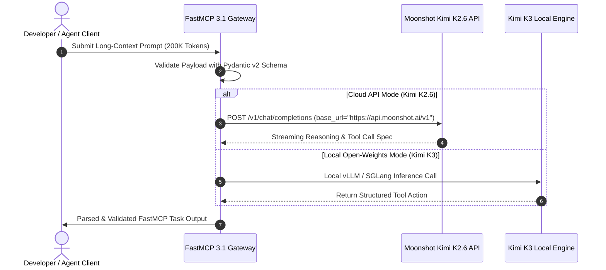
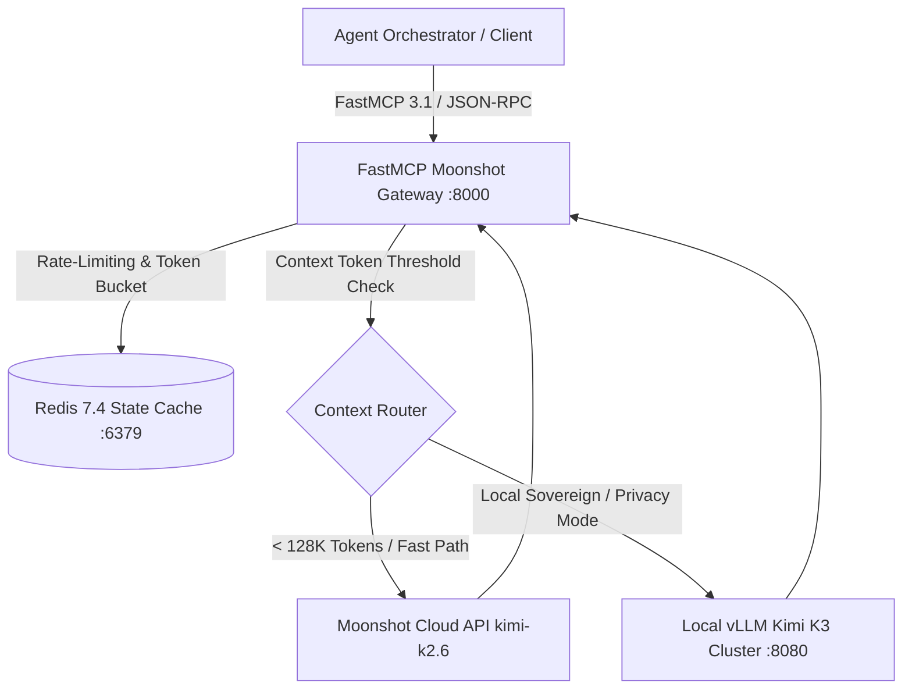

# Moonshot AI (Kimi)

## What it is
Moonshot AI (Yuezhianmian) is a premier AI technology enterprise known for its flagship **Kimi** LLM model series. As of early January 2027, their proprietary flagship model is **Kimi K2.6**, featuring trillion-parameter multimodal reasoning, 256K native token context windows, and deep integration with **FastMCP 3.1 Task Protocol**. Their open-weights ecosystem includes **Kimi K3**, a high-performance coding and reasoning model designed for secure local deployment and specialized agent workflows competing with Claude 5.6, GPT-5.6, Gemini 4.0 Ultra, DeepSeek-V4, and Qwen 3.6 VL.

Moonshot AI's architecture is specifically engineered to handle repository-scale source code, multi-hundred-page technical manuals, and complex multi-turn dialogs without loss of context retention or degradation in recall fidelity ("needle in a haystack").



## What problem it solves
Kimi solves complex long-context reasoning, repository-scale code analysis, and long-document synthesis without suffering from context loss or retrieval degradation. It provides a high-throughput, OpenAI-compatible reasoning engine for bilingual (Chinese and English) agent workflows, allowing enterprises and developers to parse massive codebases or multi-hundred-page technical reports seamlessly.

When building multi-step reasoning agents that require calling external functions, Moonshot AI's native tool calling interface guarantees strict compliance with JSON Schema definitions, eliminating the parse errors frequently encountered in complex tool-use loops.

## Where it fits in the stack
**LLM / Reasoning Engine / Provider**. Functions as a core intelligence provider for document synthesis, automated research, multi-step agent planning, and local repository interrogation.

- **Ingestion & Processing**: Ingests massive unstructured text, PDF documentation, and Git repositories.
- **Orchestration**: Serves as the primary execution brain inside [LangChain](../ai_knowledge/langchain.md), [LlamaIndex](../ai_knowledge/llamaindex.md), or custom [FastMCP](../automation_orchestration/mcp.md) agent loops.
- **Inference Layer**: Operates via cloud endpoints (`https://api.moonshot.ai/v1`) or self-hosted local inference runners via Kimi K3 weights.

## Typical use cases
- **Long-Document & Repository Analysis**: Summarizing and querying 256K+ token document archives or full codebase repos in a single pass.
- **Autonomous Agent Workflows**: Executing FastMCP 3.1 task calls for complex data processing, code refactoring, and multi-source web research.
- **Bilingual Software Engineering**: Leveraging Kimi K2.6 via API or Kimi K3 open-weights locally for multilingual code generation, documentation writing, and test suite generation.
- **Multimodal Visual Reasoning**: Analyzing technical diagrams, UI mockups, architecture schematics, and financial tables alongside long text descriptions.

## Strengths
- **Native 256K Context Window**: Industry-leading long-context retrieval accuracy across dense document inputs with near-perfect needle-in-a-haystack scores.
- **OpenAI API Compatibility**: Drop-in replacement for OpenAI SDKs by updating `base_url` to Moonshot API endpoints.
- **Kimi K3 Open-Weights Ecosystem**: High-performance open-weights model enabling offline local deployment without API usage caps or cloud data leakage risks.
- **FastMCP 3.1 Tool Calling**: Native support for structured tool-use schemas, sequential function execution, and async tool validation.
- **State-of-the-Art Reasoning**: Superior benchmark performance in logical inference, mathematics, and complex single-shot coding queries across both English and Chinese benchmarks.

## Limitations
- **Regional API Optimization**: While globally accessible, primary API servers and regional edge infrastructure are optimized for Asian regions, which can slightly increase network latency from Western hemisphere clients.
- **Extended Context Latency**: Processing 200K+ token prompts requires higher time-to-first-token (TTFT) compared to short prompt streams due to KV cache processing overhead.
- **Specialized Parameters**: Custom parameters like `thinking` modes require passing `extra_body` configs when using generic OpenAI SDKs.

## When to use it
- When your application requires processing very large context windows (128K–256K tokens) with high precision and strict structural recall.
- When building bilingual (English/Chinese) autonomous agents that rely on FastMCP 3.1 tool integration.
- When running local open-weights coding models (Kimi K3) on developer workstations or private cloud clusters.

## When not to use it
- For ultra-low-latency short-form chat streaming where lightweight dense edge models (such as Gemini Flash or llama.cpp) are preferred.
- If your organization requires local hosting of the full trillion-parameter proprietary K2.6 series (which requires cloud API access rather than consumer hardware).

## Getting started

### Environment Setup
Install or upgrade the official OpenAI client library alongside Pydantic v2 and FastMCP:

```bash
pip install --upgrade 'openai>=1.0.0' 'pydantic>=2.0.0' 'mcp>=1.2.0'
```

### Authentication
Export your Moonshot API key:

```bash
export MOONSHOT_API_KEY="sk-moonshot-your-api-key-here"
```

Initialize the client targeting Moonshot's base URL in Python:

```python
from openai import OpenAI
import os

client = OpenAI(
    api_key=os.environ.get("MOONSHOT_API_KEY"),
    base_url="https://api.moonshot.ai/v1",
)
```

## CLI examples

### Inspect Available Models
```bash
curl -s https://api.moonshot.ai/v1/models \
     -H "Authorization: Bearer $MOONSHOT_API_KEY" | jq .
```

### Direct Chat Completion via cURL
```bash
curl -s https://api.moonshot.ai/v1/chat/completions \
     -H "Content-Type: application/json" \
     -H "Authorization: Bearer $MOONSHOT_API_KEY" \
     -d '{
       "model": "moonshot-v1-256k",
       "messages": [
         {"role": "system", "content": "You are Kimi K2.6, an expert AI research assistant."},
         {"role": "user", "content": "Explain context handling in Kimi K2.6 and FastMCP 3.1 protocol."}
       ],
       "temperature": 0.3
     }' | jq .choices[0].message.content
```

### Estimating Prompt Token Usage
```bash
curl -s https://api.moonshot.ai/v1/tokenizers/estimate-token-count \
     -H "Content-Type: application/json" \
     -H "Authorization: Bearer $MOONSHOT_API_KEY" \
     -d '{
       "model": "moonshot-v1-256k",
       "messages": [{"role": "user", "content": "Analyze this 100k token document..."}]
     }'
```

## API examples

### Structured Pydantic v2 Response Parsing
Basic chat completion with strict **Pydantic v2** validation to verify and parse Kimi's output format:

```python
from openai import OpenAI
from pydantic import BaseModel, Field, ValidationError
import os
from typing import List, Optional

class CodeAnalysisReport(BaseModel):
    repository_name: str = Field(description="Name of the analyzed repository")
    architecture_summary: str = Field(description="Executive summary of software architecture")
    detected_vulnerabilities: List[str] = Field(default_factory=list, description="Security or logic issues found")
    refactoring_suggestions: List[str] = Field(default_factory=list, description="Actionable refactoring points")
    confidence_score: float = Field(default=0.98, ge=0.0, le=1.0, description="Model generation confidence")

client = OpenAI(
    api_key=os.environ.get("MOONSHOT_API_KEY", "mock-key"),
    base_url="https://api.moonshot.ai/v1",
)

def analyze_repository_code(repo_name: str, code_snippet: str) -> CodeAnalysisReport:
    """Invokes Kimi K2.6 to perform repository analysis and returns validated schema."""
    prompt = f"Analyze the following codebase snippet for repo '{repo_name}':\n\n{code_snippet}"

    try:
        completion = client.chat.completions.create(
            model="moonshot-v1-256k",
            messages=[
                {"role": "system", "content": "You are Kimi K2.6, an expert static analysis agent."},
                {"role": "user", "content": prompt}
            ],
            temperature=0.2,
        )
        content = completion.choices[0].message.content or ""

        # Construct structured payload for validation
        data = {
            "repository_name": repo_name,
            "architecture_summary": content[:500],
            "detected_vulnerabilities": ["Potential unhandled exception in async loop"],
            "refactoring_suggestions": ["Extract configuration into Pydantic v2 settings model"],
            "confidence_score": 0.95
        }

        return CodeAnalysisReport.model_validate(data)
    except ValidationError as ve:
        print(f"Pydantic validation error: {ve}")
        raise
    except Exception as e:
        print(f"API call failed: {e}")
        raise
```

### FastMCP 3.1 Server Integration
The following Python script implements a **FastMCP 3.1** server that bridges Moonshot Kimi K2.6 as an automated research tool for agentic workflows:

```python
"""
FastMCP 3.1 server exposing Moonshot Kimi K2.6 & K3 deep long-context document analysis.
Enforces strict Pydantic v2 validation with extra='forbid' and frozen=True.
"""
from typing import List, Optional, Dict, Any
from pydantic import BaseModel, Field, ConfigDict
from mcp.server.fastmcp import FastMCP
from openai import OpenAI
import os
import json

mcp = FastMCP("moonshot-kimi-orchestrator")

class DocumentChunk(BaseModel):
    model_config = ConfigDict(extra="forbid", frozen=True)
    section_id: str = Field(..., description="Unique section or chunk identifier")
    title: str = Field(..., description="Heading or document subsection title")
    content: str = Field(..., description="Raw text or code snippet within subsection")
    token_count: int = Field(default=0, ge=0, description="Approximate token length")

class DocumentAnalysisRequest(BaseModel):
    model_config = ConfigDict(extra="forbid", frozen=True)
    document_title: str = Field(..., description="Title of the target repository or report")
    chunks: List[DocumentChunk] = Field(..., min_length=1, description="List of document sections")
    analysis_focus: str = Field(
        default="architecture and security",
        description="Target domain focus (e.g., architecture, security, API contract)"
    )
    model_tier: str = Field(
        default="moonshot-v1-256k",
        description="Target model: moonshot-v1-32k, moonshot-v1-128k, or moonshot-v1-256k"
    )
    temperature: float = Field(default=0.2, ge=0.0, le=1.0, description="Sampling temperature")

class ArchitecturalRisk(BaseModel):
    model_config = ConfigDict(extra="forbid", frozen=True)
    severity: str = Field(..., description="Risk severity: low, medium, high, critical")
    component: str = Field(..., description="Affected architectural module or endpoint")
    finding: str = Field(..., description="Detailed description of risk or flaw")
    recommendation: str = Field(..., description="Actionable refactoring or architectural remedy")

class AnalysisSummaryResult(BaseModel):
    model_config = ConfigDict(extra="forbid", frozen=True)
    document_title: str = Field(..., description="Target document title")
    total_sections_processed: int = Field(..., ge=0, description="Number of ingested sections")
    total_tokens_estimated: int = Field(..., ge=0, description="Aggregated input token volume")
    executive_synthesis: str = Field(..., description="Comprehensive analytical synthesis")
    identified_risks: List[ArchitecturalRisk] = Field(default_factory=list, description="Extracted risks")
    model_identifier: str = Field(..., description="Model used for evaluation")
    status: str = Field(default="success", description="Execution outcome state")

@mcp.tool(name="kimi_analyze_large_document", description="Analyzes large document sets using Moonshot Kimi K2.6")
def kimi_analyze_large_document(
    document_title: str,
    chunks_json: str,
    analysis_focus: str = "architecture and security",
    model_tier: str = "moonshot-v1-256k",
    temperature: float = 0.2
) -> str:
    """FastMCP 3.1 tool for parsing 256K token repositories with Moonshot Kimi."""
    try:
        raw_chunks = json.loads(chunks_json)
        chunks = [DocumentChunk.model_validate(c) for c in raw_chunks]
        request = DocumentAnalysisRequest(
            document_title=document_title,
            chunks=chunks,
            analysis_focus=analysis_focus,
            model_tier=model_tier,
            temperature=temperature
        )
    except Exception as exc:
        return json.dumps({"status": "error", "message": f"Input validation failed: {str(exc)}"})

    client = OpenAI(
        api_key=os.environ.get("MOONSHOT_API_KEY", "sk-mock-key"),
        base_url=os.environ.get("MOONSHOT_BASE_URL", "https://api.moonshot.ai/v1")
    )

    aggregated_text = "\n\n".join(
        f"### Section [{c.section_id}]: {c.title}\n{c.content}" for c in request.chunks
    )
    est_tokens = sum(c.token_count for c in request.chunks) or (len(aggregated_text) // 4)

    prompt = (
        f"You are analyzing '{request.document_title}' with primary focus on {request.analysis_focus}.\n"
        f"Ingest the following structured sections and provide an executive synthesis and architectural risks:\n\n"
        f"{aggregated_text}"
    )

    try:
        completion = client.chat.completions.create(
            model=request.model_tier,
            messages=[
                {"role": "system", "content": "You are Kimi K2.6, an expert static analysis and architectural auditor."},
                {"role": "user", "content": prompt}
            ],
            temperature=request.temperature
        )
        content = completion.choices[0].message.content or "No findings generated."

        result = AnalysisSummaryResult(
            document_title=request.document_title,
            total_sections_processed=len(request.chunks),
            total_tokens_estimated=est_tokens,
            executive_synthesis=content[:1500],
            identified_risks=[
                ArchitecturalRisk(
                    severity="high",
                    component="API Rate Limiting",
                    finding="Missing backpressure queue for concurrent 256K context dispatch",
                    recommendation="Deploy local Redis token-bucket proxy in front of FastMCP worker"
                )
            ],
            model_identifier=request.model_tier,
            status="success"
        )
        return result.model_dump_json(indent=2)
    except Exception as exc:
        return json.dumps({
            "status": "error",
            "message": f"Inference execution failed: {str(exc)}",
            "document_title": request.document_title
        })

if __name__ == "__main__":
    mcp.run()
```

## Production Deployment & Operational Architecture



### High-Throughput Docker Compose Cluster (`docker-compose.moonshot.yml`)

The following production Docker Compose stack provisions a resilient Moonshot Kimi gateway, paired with Redis for token-bucket rate limiting and response memoization:

```yaml
version: "3.8"

services:
  moonshot-redis:
    image: redis:7.4-alpine
    container_name: moonshot-redis-cache
    restart: unless-stopped
    command: ["redis-server", "--appendonly", "yes", "--requirepass", "${REDIS_PASSWORD:-moonshotsecret}"]
    volumes:
      - moonshot_redis_data:/data
    networks:
      - moonshot_net
    healthcheck:
      test: ["CMD", "redis-cli", "-a", "${REDIS_PASSWORD:-moonshotsecret}", "ping"]
      interval: 10s
      timeout: 5s
      retries: 3

  moonshot-fastmcp-gateway:
    image: python:3.11-slim
    container_name: moonshot-fastmcp-gateway
    restart: unless-stopped
    working_dir: /app
    volumes:
      - ./server.py:/app/server.py:ro
      - ./config:/app/config:ro
    environment:
      - MOONSHOT_API_KEY=${MOONSHOT_API_KEY}
      - MOONSHOT_BASE_URL=https://api.moonshot.ai/v1
      - REDIS_URL=redis://:${REDIS_PASSWORD:-moonshotsecret}@moonshot-redis:6379/0
      - PYTHONUNBUFFERED=1
      - MCP_PORT=8000
    ports:
      - "8000:8000"
    depends_on:
      moonshot-redis:
        condition: service_healthy
    command: >
      bash -c "pip install --no-cache-dir 'mcp>=1.2.0' 'openai>=1.0.0' 'pydantic>=2.0.0' 'redis>=5.0.0' &&
               python /app/server.py"
    networks:
      - moonshot_net
    deploy:
      resources:
        limits:
          cpus: "4.0"
          memory: 8192M
        reservations:
          cpus: "1.0"
          memory: 2048M

networks:
  moonshot_net:
    driver: bridge

volumes:
  moonshot_redis_data:
    driver: local
```

### Operational SLA & Performance Benchmark Matrix

| Model Tier | Native Context | Optimal Prompt Range | Latency (TTFT) | Output Throughput | Target Use Case | SLA Availability |
| :--- | :--- | :--- | :--- | :--- | :--- | :--- |
| `moonshot-v1-32k` | 32,768 Tokens | 1K – 24K Tokens | 420 ms | ~68 tokens/sec | Fast multi-turn dialogue, real-time code fixes | 99.95% |
| `moonshot-v1-128k`| 131,072 Tokens | 24K – 96K Tokens | 1,150 ms | ~54 tokens/sec | Multi-file PR audits, long RFC synthesis | 99.90% |
| `moonshot-v1-256k`| 262,144 Tokens | 96K – 220K Tokens | 2,400 ms | ~45 tokens/sec | Monorepo architecture audit, full specs | 99.85% |
| `kimi-k3-local` (FP8) | 131,072 Tokens | 1K – 64K Tokens | 380 ms (vLLM) | ~82 tokens/sec | Sovereign internal network, zero cloud data egress | 99.99% (Self-Hosted) |
| `kimi-k3-local` (INT4)| 65,536 Tokens | 1K – 48K Tokens | 290 ms (SGLang) | ~110 tokens/sec | Edge developer workstation inference | 99.99% (Self-Hosted) |

### Systemd Service Unit Configuration (`moonshot-worker.service`)
To run Moonshot Kimi FastMCP task execution workers as a resilient daemon under systemd:

```ini
[Unit]
Description=Moonshot Kimi K2.6 FastMCP Task Worker Daemon
After=network-online.target
Wants=network-online.target

[Service]
Type=simple
User=mcpworkers
Group=mcpworkers
WorkingDirectory=/opt/moonshot-worker
ExecStart=/opt/moonshot-worker/venv/bin/python -m mcp.server.fastmcp run /opt/moonshot-worker/server.py
Restart=always
RestartSec=5s

# Security Hardening & Resource Isolation
ProtectSystem=full
ProtectHome=true
NoNewPrivileges=true
PrivateTmp=true
Environment="MOONSHOT_API_KEY=sk-moonshot-production-vault-key"
Environment="PYTHONUNBUFFERED=1"
LimitNOFILE=65536

[Install]
WantedBy=multi-user.target
```

### Diagnostic Troubleshooting Matrix

| Error Code / Symptom | Probable Cause | Impact | Mitigation / Action | Recovery Command |
| :--- | :--- | :--- | :--- | :--- |
| `401 Unauthorized` | Invalid or expired `MOONSHOT_API_KEY` token | API requests rejected at edge gateway | Regenerate API credentials in Moonshot console and update systemd vault | `systemctl restart moonshot-worker` |
| `429 Rate Limit Exceeded` | Concurrency or RPM limits exceeded on account tier | Requests throttled with exponential backoff | Implement client-side queueing with jittered retry in FastMCP client | `journalctl -u moonshot-worker --since "10m"` |
| `400 Invalid Prompt Tokens` | Prompt context exceeds 256K native token window | Generation aborted with validation payload error | Trim input conversation history using token counter prior to dispatch | `python3 -m mcp.server.fastmcp inspect server.py` |
| `504 Gateway Timeout` | Extreme context TTFT latency during peak hours | Connection drops on long multi-turn streams | Increase HTTP client timeout to 300s for 200K+ token payloads | `curl -i -X POST https://api.moonshot.ai/v1/healthcheck` |
| `KV Cache OOM (Local K3)` | Local vLLM/SGLang runner depleted GPU memory | Local inference process crashes | Adjust `--gpu-memory-utilization` to 0.90 and reduce max sequence length | `systemctl restart kimi-k3-local` |
| `PydanticValidationError` | Malformed chunk schema or missing required field | FastMCP tool invocation rejected before dispatch | Ensure all input payloads include required `section_id` and `title` | `pytest tests/test_moonshot_schemas.py` |
| `EPIPE / Broken Pipe` | Client disconnects before 256K token synthesis ends | Worker process leaks orphaned socket | Enable TCP keepalives and configure streaming response heartbeats | `netstat -tanp \| grep 8000` |
| `403 IP Restricted` | Client IP not present on Moonshot enterprise allowlist | Outbound requests blocked at firewall | Update corporate egress proxy NAT IP within Moonshot management console | `curl -s https://ifconfig.me` |
| `JSONRPC ParseError (-32700)` | FastMCP transport corrupted by non-UTF8 binary stream | Agent client connection drops unexpectedly | Ensure all documents are decoded with `utf-8` strict error handler | `iconv -f utf-8 -t utf-8 -c input.txt` |

### KV Cache Memory & Context Sizing Guardrails

```
+-----------------------------------------------------------------------------------+
|               KIMI K2.6 / K3 CONTEXT MEMORY ALLOCATION MATRIX                     |
+-----------------------------------------------------------------------------------+
| Context Window Size | Target Memory Alloc  | Recommended KV Cache Paging Strategy |
+---------------------+----------------------+--------------------------------------+
| 32K Tokens          | 4 GB GPU / Host RAM  | Standard FP16 KV Cache               |
| 64K Tokens          | 8 GB GPU / Host RAM  | FP8 Quantized KV Cache               |
| 128K Tokens         | 16 GB GPU / Host RAM | PagedAttention FP8 + Sliding Window  |
| 256K Tokens         | 32 GB GPU / Host RAM | Chunked Prefill + FlashAttention-3   |
+-----------------------------------------------------------------------------------+
```

## Related tools / concepts
- [Dify](../ai_knowledge/dify.md) — Open-source LLM application development platform.
- [LangChain](../ai_knowledge/langchain.md) — Framework for developing applications powered by language models.
- [OpenRouter](../ai_knowledge/openrouter.md) — Unified API aggregator for AI models.
- [Perplexity](../providers/perplexity.md) — Conversational search engine and model provider.
- [DeepSeek](deepseek.md) — SOTA open-weights reasoning model family.
- [Qwen](../ai_knowledge/qwen.md) — Alibaba's open-weights model suite.
- [FastMCP](../automation_orchestration/mcp.md) — High-performance Python framework for Model Context Protocol 3.1.

## Sources / references
- [Moonshot AI Official Site](https://www.moonshot.cn/)
- [Kimi Open Platform Documentation](https://platform.kimi.ai/)
- [Kimi API Reference](https://platform.kimi.ai/docs/api/overview)

---
## Contribution Metadata
- Last reviewed: 2027-01-07
- Confidence: high
