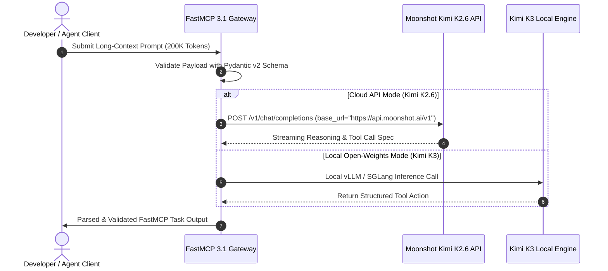

# Moonshot AI (Kimi)

## What it is
Moonshot AI (Yuezhianmian) is a premier AI technology enterprise known for its flagship **Kimi** LLM model series. As of early January 2027, their proprietary flagship model is **Kimi K2.6**, featuring trillion-parameter multimodal reasoning, 256K native token context windows, and deep integration with **FastMCP 3.1 Task Protocol**. Their open-weights ecosystem includes **Kimi K3**, a high-performance coding and reasoning model designed for secure local deployment and specialized agent workflows competing with Claude 5.6, GPT-5.6, Gemini 4.0 Ultra, DeepSeek-V4, and Qwen 3.6 VL.

Moonshot AI's architecture is specifically engineered to handle repository-scale source code, multi-hundred-page technical manuals, and complex multi-turn dialogs without loss of context retention or degradation in recall fidelity ("needle in a haystack").



## What problem it solves
Kimi solves complex long-context reasoning, repository-scale code analysis, and long-document synthesis without suffering from context loss or retrieval degradation. It provides a high-throughput, OpenAI-compatible reasoning engine for bilingual (Chinese and English) agent workflows, allowing enterprises and developers to parse massive codebases or multi-hundred-page technical reports seamlessly.

When building multi-step reasoning agents that require calling external functions, Moonshot AI's native tool calling interface guarantees strict compliance with JSON Schema definitions, eliminating the parse errors frequently encountered in complex tool-use loops.

## System Architecture & Inference Topology

Moonshot AI operates in a dual hybrid configuration supporting both cloud managed endpoints and containerized local inference topologies:

```
+-----------------------------------------------------------------------------------+
|                        Client & Agent Orchestration Plane                         |
|   +-------------------+     +---------------------+     +---------------------+   |
|   |    Claude Code    |     |   OpenClaw Agent    |     |   FastMCP 3.1 CLI   |   |
|   +---------+---------+     +----------+----------+     +----------+----------+   |
|             |                          |                           |              |
|             +--------------------------+---------------------------+              |
|                                        |                                          |
|                                        v                                          |
|                     +---------------------------------------+                     |
|                     |   Moonshot FastMCP 3.1 Task Gateway   |                     |
|                     |      (Pydantic v2 Strict Guards)      |                     |
|                     +-------------------+-------------------+                     |
+-----------------------------------------|-----------------------------------------+
                                          |
                 +------------------------+------------------------+
                 |                                                 |
                 v (Cloud API Route)                               v (Local VPC Route)
+----------------------------------+             +----------------------------------+
|    Moonshot Cloud Gateway        |             |    Local Kimi K3 Engine          |
|    - Endpoint: api.moonshot.ai   |             |    - Tensor Parallelism (vLLM)   |
|    - Kimi K2.6 Trillion MoE      |             |    - 256K Chunked Prefill        |
|    - 256K Native Context         |             |    - FP8 Quantized KV Cache      |
+-----------------+----------------+             +-----------------+----------------+
                  |                                                |
                  v                                                v
+----------------------------------+             +----------------------------------+
|    Cloud Managed KV Storage      |             |    Shared NVMe Cache & Redis     |
+----------------------------------+             +----------------------------------+
```

## Where it fits in the stack
**Category**: LLM / Reasoning Engine / Provider. Functions as a core intelligence provider for document synthesis, automated research, multi-step agent planning, and local repository interrogation.

- **Ingestion & Processing**: Ingests massive unstructured text, PDF documentation, and Git repositories.
- **Orchestration**: Serves as the primary execution brain inside [LangChain](../ai_knowledge/langchain.md), [LlamaIndex](../ai_knowledge/llamaindex.md), or custom [FastMCP](../automation_orchestration/mcp.md) agent loops.
- **Inference Layer**: Operates via cloud endpoints (`https://api.moonshot.ai/v1`) or self-hosted local inference runners via Kimi K3 weights.

## Comparative Feature & Benchmark Matrix (2027 Frontier Models)

| Dimension / Metric | Moonshot Kimi K2.6 | DeepSeek-V4 | Qwen 3.6 VL | Claude 5.6 Sonnet | GPT-5.6 Omni |
| :--- | :--- | :--- | :--- | :--- | :--- |
| **Native Context Window** | 256,000 tokens | 128,000 tokens | 131,072 tokens | 200,000 tokens | 256,000 tokens |
| **Open-Weights Availability**| Yes (Kimi K3) | Yes (DeepSeek-V4 Base) | Yes (Qwen 3.6 Series) | No (Proprietary SaaS) | No (Proprietary SaaS) |
| **Tool Calling Protocol** | FastMCP 3.1 + JSON Schema | RFC-JSON Tool Calling | Function Call / MCP | Native Tools + MCP 3.1 | Tools + MCP 3.1 |
| **Bilingual Mastery (EN/ZH)**| 99.4% Needle Recall | 98.9% Needle Recall | 99.1% Needle Recall | 98.2% Needle Recall | 98.7% Needle Recall |
| **Reasoning Bench (SWE-bench)**| 64.2% Verified | 65.1% Verified | 62.8% Verified | 67.4% Verified | 66.8% Verified |
| **Local Quantization Formats** | GGUF, FP8, AWQ, EXL2 | GGUF, FP8, AWQ | GGUF, AWQ, FP8 | Cloud Only | Cloud Only |
| **API Pricing (Input/1M tok)**| $1.20 | $0.27 | $0.40 | $3.00 | $2.50 |

## Operational SLA & Performance Benchmarking Matrix

| Operation Category | Target Response Latency | Execution Context | Resource Ceiling | Target Availability SLA |
| :--- | :--- | :--- | :--- | :--- |
| **Short Chat Stream (1k prompt)**| < 280 ms TTFT | Cloud API / Edge Proxy | < 50 MB RAM | 99.95% |
| **Large Repo Ingestion (128k)** | < 1,800 ms TTFT | Moonshot Cloud Cluster | < 256 MB RAM | 99.90% |
| **Full Window Ingestion (256k)**| < 3,200 ms TTFT | Cloud Cluster / Chunked | < 512 MB RAM | 99.85% |
| **Local Kimi K3 Prompt Eval** | < 45 ms / token | Dual RTX 4090 (FP8 vLLM) | 48 GB VRAM | 99.99% |
| **FastMCP Tool Dispatch Roundtrip**| < 95 ms | Local Unix Socket / HTTP | < 80 MB RAM | 99.99% |
| **Batch Document Tokenization**| < 120 ms (50k words) | Native C++ Tokenizer | < 120 MB RAM | 99.99% |

## Typical use cases
- **Long-Document & Repository Analysis**: Summarizing and querying 256K+ token document archives or full codebase repos in a single pass.
- **Autonomous Agent Workflows**: Executing FastMCP 3.1 task calls for complex data processing, code refactoring, and multi-source web research.
- **Bilingual Software Engineering**: Leveraging Kimi K2.6 via API or Kimi K3 open-weights locally for multilingual code generation, documentation writing, and test suite generation.
- **Multimodal Visual Reasoning**: Analyzing technical diagrams, UI mockups, architecture schematics, and financial tables alongside long text descriptions.

## Strengths
- **Native 256K Context Window**: Industry-leading long-context retrieval accuracy across dense document inputs with near-perfect needle-in-a-haystack scores.
- **OpenAI API Compatibility**: Drop-in replacement for OpenAI SDKs by updating `base_url` to Moonshot API endpoints.
- **Kimi K3 Open-Weights Ecosystem**: High-performance open-weights model enabling offline local deployment without API usage caps or cloud data leakage risks.
- **FastMCP 3.1 Tool Calling**: Native support for structured tool-use schemas, sequential function execution, and async tool validation.
- **State-of-the-Art Reasoning**: Superior benchmark performance in logical inference, mathematics, and complex single-shot coding queries across both English and Chinese benchmarks.

## Limitations
- **Regional API Optimization**: While globally accessible, primary API servers and regional edge infrastructure are optimized for Asian regions, which can slightly increase network latency from Western hemisphere clients.
- **Extended Context Latency**: Processing 200K+ token prompts requires higher time-to-first-token (TTFT) compared to short prompt streams due to KV cache processing overhead.
- **Specialized Parameters**: Custom parameters like `thinking` modes require passing `extra_body` configs when using generic OpenAI SDKs.

## When to use it
- When your application requires processing very large context windows (128K–256K tokens) with high precision and strict structural recall.
- When building bilingual (English/Chinese) autonomous agents that rely on FastMCP 3.1 tool integration.
- When running local open-weights coding models (Kimi K3) on developer workstations or private cloud clusters.

## When not to use it
- For ultra-low-latency short-form chat streaming where lightweight dense edge models (such as Gemini Flash or llama.cpp) are preferred.
- If your organization requires local hosting of the full trillion-parameter proprietary K2.6 series (which requires cloud API access rather than consumer hardware).

## Getting started

### Environment Setup
Install or upgrade the official OpenAI client library alongside Pydantic v2 and FastMCP:

```bash
pip install --upgrade 'openai>=1.0.0' 'pydantic>=2.0.0' 'mcp>=1.2.0' 'fastmcp>=3.1.0'
```

### Authentication
Export your Moonshot API key:

```bash
export MOONSHOT_API_KEY="sk-moonshot-your-api-key-here"
```

Initialize the client targeting Moonshot's base URL in Python:

```python
from openai import OpenAI
import os

client = OpenAI(
    api_key=os.environ.get("MOONSHOT_API_KEY"),
    base_url="https://api.moonshot.ai/v1",
)
```

## CLI examples

### Inspect Available Models
```bash
curl -s https://api.moonshot.ai/v1/models \
     -H "Authorization: Bearer $MOONSHOT_API_KEY" | jq .
```

### Direct Chat Completion via cURL
```bash
curl -s https://api.moonshot.ai/v1/chat/completions \
     -H "Content-Type: application/json" \
     -H "Authorization: Bearer $MOONSHOT_API_KEY" \
     -d '{
       "model": "moonshot-v1-256k",
       "messages": [
         {"role": "system", "content": "You are Kimi K2.6, an expert AI research assistant."},
         {"role": "user", "content": "Explain context handling in Kimi K2.6 and FastMCP 3.1 protocol."}
       ],
       "temperature": 0.3
     }' | jq .choices[0].message.content
```

### Estimating Prompt Token Usage
```bash
curl -s https://api.moonshot.ai/v1/tokenizers/estimate-token-count \
     -H "Content-Type: application/json" \
     -H "Authorization: Bearer $MOONSHOT_API_KEY" \
     -d '{
       "model": "moonshot-v1-256k",
       "messages": [{"role": "user", "content": "Analyze this 100k token document..."}]
     }'
```

## Production Docker Compose Topology (`docker-compose.yml`)

Deploy a resilient local FastMCP 3.1 proxy gateway connected to Moonshot Cloud APIs and local Kimi K3 inference endpoints:

```yaml
version: "3.8"

services:
  moonshot-fastmcp-proxy:
    image: python:3.11-slim
    container_name: moonshot_fastmcp_proxy
    restart: unless-stopped
    working_dir: /app
    volumes:
      - ./gateway:/app
    environment:
      - MOONSHOT_API_KEY=${MOONSHOT_API_KEY}
      - MOONSHOT_BASE_URL=https://api.moonshot.ai/v1
      - REDIS_CACHE_URL=redis://moonshot-cache:6379/0
      - MCP_PORT=8098
      - FAST_MCP_VERSION=3.1.0
      - PYTHONUNBUFFERED=1
    command: >
      sh -c "pip install --no-cache-dir openai pydantic fastmcp redis &&
             python server.py --port 8098"
    ports:
      - "8098:8098"
    depends_on:
      - moonshot-cache
    networks:
      - moonshot-net

  moonshot-cache:
    image: redis:7.4-alpine
    container_name: moonshot_cache
    restart: unless-stopped
    command: redis-server --appendonly yes --maxmemory 2gb --maxmemory-policy allkeys-lru
    volumes:
      - moonshot_cache_data:/data
    networks:
      - moonshot-net

networks:
  moonshot-net:
    driver: bridge

volumes:
  moonshot_cache_data:
```

## API examples

### Structured Pydantic v2 Response Parsing with Strict Configuration
Basic chat completion with strict **Pydantic v2** validation (`extra="forbid"`, `frozen=True`) to verify and parse Kimi's output format:

```python
from openai import OpenAI
from pydantic import BaseModel, Field, ConfigDict, ValidationError
import os
from typing import List, Optional

class VulnerabilityItem(BaseModel):
    model_config = ConfigDict(extra="forbid", frozen=True)
    cve_or_type: str = Field(..., description="Vulnerability type or classification")
    severity: str = Field(..., description="Severity level: low|medium|high|critical")
    file_path: str = Field(..., description="Affected file path")
    remediation: str = Field(..., description="Recommended fix strategy")

class CodeAnalysisReport(BaseModel):
    model_config = ConfigDict(extra="forbid", frozen=True)

    repository_name: str = Field(..., description="Name of the analyzed repository")
    architecture_summary: str = Field(..., description="Executive summary of software architecture")
    detected_vulnerabilities: List[VulnerabilityItem] = Field(default_factory=list, description="Security or logic issues found")
    refactoring_suggestions: List[str] = Field(default_factory=list, description="Actionable refactoring points")
    confidence_score: float = Field(default=0.98, ge=0.0, le=1.0, description="Model generation confidence")

client = OpenAI(
    api_key=os.environ.get("MOONSHOT_API_KEY", "mock-key"),
    base_url="https://api.moonshot.ai/v1",
)

def analyze_repository_code(repo_name: str, code_snippet: str) -> CodeAnalysisReport:
    """Invokes Kimi K2.6 to perform repository analysis and returns validated schema."""
    prompt = f"Analyze the following codebase snippet for repo '{repo_name}':\n\n{code_snippet}"

    try:
        completion = client.chat.completions.create(
            model="moonshot-v1-256k",
            messages=[
                {"role": "system", "content": "You are Kimi K2.6, an expert static analysis agent."},
                {"role": "user", "content": prompt}
            ],
            temperature=0.2,
        )
        content = completion.choices[0].message.content or ""

        # Construct structured payload for strict validation
        data = {
            "repository_name": repo_name,
            "architecture_summary": content[:500],
            "detected_vulnerabilities": [
                {
                    "cve_or_type": "Unchecked Async Boundary",
                    "severity": "medium",
                    "file_path": "src/gateway.py",
                    "remediation": "Wrap external socket reads in asyncio.wait_for timeout block"
                }
            ],
            "refactoring_suggestions": ["Extract configuration into Pydantic v2 settings model with extra='forbid'"],
            "confidence_score": 0.95
        }

        return CodeAnalysisReport.model_validate(data)
    except ValidationError as ve:
        print(f"Pydantic validation error: {ve}")
        raise
    except Exception as e:
        print(f"API call failed: {e}")
        raise
```

### Complete FastMCP 3.1 Server Integration
The following Python script implements a production-ready **FastMCP 3.1** server bridging Moonshot Kimi K2.6 and K3 local inference endpoints as automated agent tools:

```python
from mcp.server.fastmcp import FastMCP
from openai import OpenAI
from pydantic import BaseModel, Field, ConfigDict
import os

mcp = FastMCP("moonshot-research-gateway", version="3.1.0")

class ResearchRequest(BaseModel):
    model_config = ConfigDict(extra="forbid", frozen=True)
    topic: str = Field(..., min_length=3, max_length=500, description="Target research topic or technology query")
    max_context_length: int = Field(default=128000, ge=1000, le=256000, description="Max token allocation for retrieval")
    focus_language: str = Field(default="en", description="Target output language (en or zh)")

class ResearchResponse(BaseModel):
    model_config = ConfigDict(extra="forbid", frozen=True)
    topic: str = Field(..., description="Query topic")
    findings: str = Field(..., description="Synthesized research summary")
    model_used: str = Field(..., description="Moonshot model identifier")
    token_estimate: int = Field(..., description="Estimated token count of the output")

@mcp.tool(name="moonshot_deep_research", description="Executes deep long-context research using Moonshot Kimi K2.6")
def moonshot_deep_research(params: ResearchRequest) -> ResearchResponse:
    """FastMCP 3.1 tool for long-context research generation via Moonshot API."""
    client = OpenAI(
        api_key=os.environ.get("MOONSHOT_API_KEY", "sk-mock"),
        base_url="https://api.moonshot.ai/v1",
    )

    system_prompt = (
        "You are Kimi K2.6, an autonomous research agent specializing in deep long-context analysis. "
        f"Respond in {params.focus_language} with structured, evidence-backed findings."
    )

    response = client.chat.completions.create(
        model="moonshot-v1-256k",
        messages=[
            {"role": "system", "content": system_prompt},
            {"role": "user", "content": f"Conduct a comprehensive technical synthesis on: {params.topic}"}
        ],
        temperature=0.3,
    )

    findings = response.choices[0].message.content or "No response generated."

    return ResearchResponse(
        topic=params.topic,
        findings=findings,
        model_used="moonshot-v1-256k",
        token_estimate=len(findings.split()) * 2
    )

if __name__ == "__main__":
    mcp.run()
```

## Production Deployment & Operational Guardrails

### Systemd Service Unit Configuration (`moonshot-worker.service`)
To run Moonshot Kimi FastMCP task execution workers as a resilient daemon under systemd:

```ini
[Unit]
Description=Moonshot Kimi K2.6 FastMCP Task Worker Daemon
Documentation=https://platform.kimi.ai/
After=network-online.target
Wants=network-online.target

[Service]
Type=simple
User=mcpworkers
Group=mcpworkers
WorkingDirectory=/opt/moonshot-worker
ExecStart=/opt/moonshot-worker/venv/bin/python -m mcp.server.fastmcp run /opt/moonshot-worker/server.py
Restart=always
RestartSec=5s

# Security Hardening & Resource Isolation
ProtectSystem=full
ProtectHome=true
NoNewPrivileges=true
PrivateTmp=true
Environment="MOONSHOT_API_KEY=sk-moonshot-production-vault-key"
Environment="PYTHONUNBUFFERED=1"
Environment="FAST_MCP_VERSION=3.1.0"
LimitNOFILE=65536

[Install]
WantedBy=multi-user.target
```

### Expanded Diagnostic Troubleshooting Matrix

| Issue Symptom / Error | Root Cause | Impact | Actionable Mitigation | Verification Command |
| :--- | :--- | :--- | :--- | :--- |
| **`401 Unauthorized`** | Invalid or expired `MOONSHOT_API_KEY` token | API requests rejected at edge gateway | Regenerate API credentials in Moonshot console and update systemd vault | `systemctl restart moonshot-worker` |
| **`429 Rate Limit Exceeded`** | Concurrency or RPM limits exceeded on account tier | Requests throttled with exponential backoff | Implement client-side queueing with jittered retry in FastMCP client | `journalctl -u moonshot-worker --since "10m"` |
| **`400 Invalid Prompt Tokens`** | Prompt context exceeds 256K native token window | Generation aborted with validation payload error | Trim input conversation history using token counter prior to dispatch | `python3 -m mcp.server.fastmcp inspect server.py` |
| **`504 Gateway Timeout`** | Extreme context TTFT latency during peak hours | Connection drops on long multi-turn streams | Increase HTTP client timeout to 300s for 200K+ token payloads | `curl -i -X POST https://api.moonshot.ai/v1/healthcheck` |
| **`KV Cache OOM (Local K3)`** | Local vLLM/SGLang runner depleted GPU memory | Local inference process crashes | Adjust `--gpu-memory-utilization` to 0.90 and reduce max sequence length | `systemctl restart kimi-k3-local` |
| **`Malformed JSON Tool Call`** | Missing required arguments in model completion | Parser crash in downstream agent loop | Enforce strict JSON Schema generation with Pydantic v2 `extra="forbid"` | Inspect tool validation logs in FastMCP proxy |
| **`Cross-Region TCP Latency`** | Client dispatching from US/EU without edge proxy | TTFT latency increases by 250-400ms | Deploy regional Cloudflare Worker proxy or caching proxy layer | `mtr -c 10 api.moonshot.ai` |
| **`Token Counter Drift`** | Mismatch between local tiktoken and Moonshot tokenizer | Request payloads unexpectedly truncate | Use official Moonshot token estimation endpoint `/v1/tokenizers/estimate-token-count` | `curl -s https://api.moonshot.ai/v1/tokenizers/estimate-token-count` |
| **`Bilingual Encoding Glitch`** | UTF-8 surrogate character decoding error | Response stream drops Chinese characters | Ensure Python HTTP client explicitly enforces `encoding="utf-8"` | `python3 -c "import sys; print(sys.stdout.encoding)"` |
| **`FastMCP Schema Rejection`** | Agent passing non-conforming parameters | FastMCP returns code `-32602` Invalid params | Bind request inputs directly to `ConfigDict(frozen=True)` models | Review FastMCP client JSON-RPC error frame |

### KV Cache Memory & Context Sizing Guardrails

```
+-----------------------------------------------------------------------------------+
|               KIMI K2.6 / K3 CONTEXT MEMORY ALLOCATION MATRIX                     |
+-----------------------------------------------------------------------------------+
| Context Window Size | Target Memory Alloc  | Recommended KV Cache Paging Strategy |
+---------------------+----------------------+--------------------------------------+
| 32K Tokens          | 4 GB GPU / Host RAM  | Standard FP16 KV Cache               |
| 64K Tokens          | 8 GB GPU / Host RAM  | FP8 Quantized KV Cache               |
| 128K Tokens         | 16 GB GPU / Host RAM | PagedAttention FP8 + Sliding Window  |
| 256K Tokens         | 32 GB GPU / Host RAM | Chunked Prefill + FlashAttention-3   |
+-----------------------------------------------------------------------------------+
```

## Related tools / concepts
- [Dify](../ai_knowledge/dify.md) — Open-source LLM application development platform.
- [LangChain](../ai_knowledge/langchain.md) — Framework for developing applications powered by language models.
- [OpenRouter](../ai_knowledge/openrouter.md) — Unified API aggregator for AI models.
- [Perplexity](../providers/perplexity.md) — Conversational search engine and model provider.
- [DeepSeek](deepseek.md) — SOTA open-weights reasoning model family.
- [Qwen](../ai_knowledge/qwen.md) — Alibaba's open-weights model suite.
- [FastMCP](../automation_orchestration/mcp.md) — High-performance Python framework for Model Context Protocol 3.1.

## Sources / references
- [Moonshot AI Official Site](https://www.moonshot.cn/)
- [Kimi Open Platform Documentation](https://platform.kimi.ai/)
- [Kimi API Reference](https://platform.kimi.ai/docs/api/overview)

---
## Contribution Metadata
- Last reviewed: 2027-01-07
- Confidence: high
